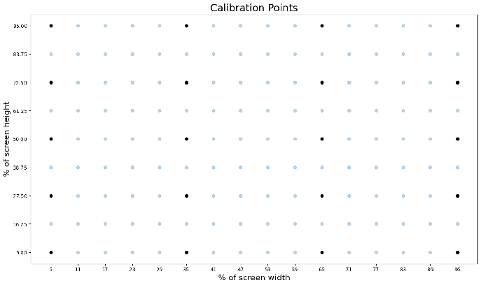
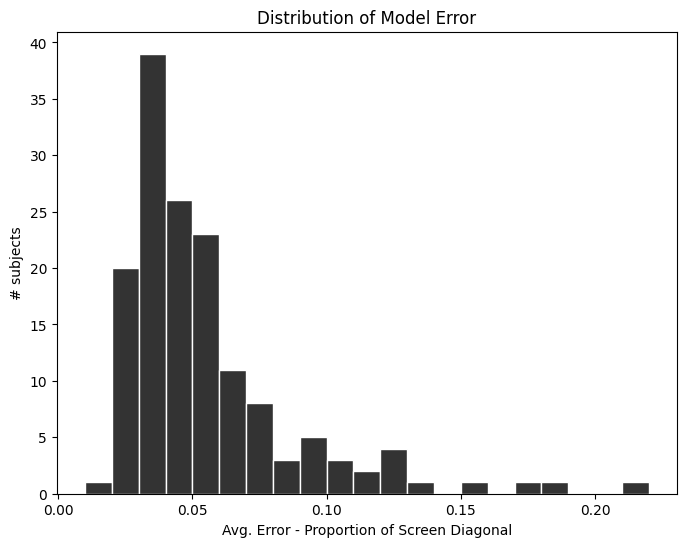
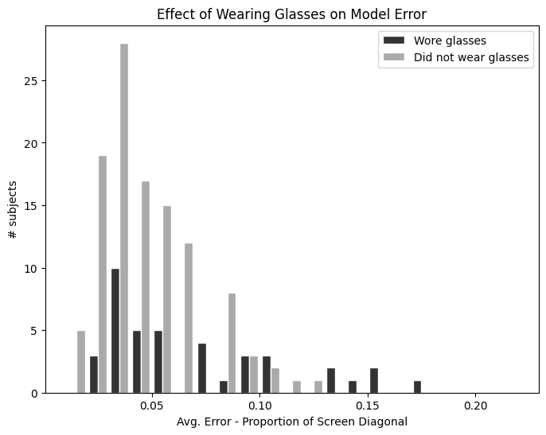

```{r}
#| label: setup
# Figures fill the text width. Without this, typst reads the SVGs' unitless sizes as pixels at
# 96 per inch, not points, and prints every figure at three quarters of its size.
knitr::opts_chunk$set(out.width = "100%")
library(readr)
library(dplyr)
library(tidyr)
library(purrr)
library(ggplot2)
library(patchwork)
library(forcats)

# The validation-study dataset: a local copy if there is one, otherwise downloaded from Zenodo.
source("R/data.R")
# Replaying the validation sessions through both trackers.
source("R/validation.R")
# Schematic icons for the recording conditions.
source("R/icons.R")

# The two trackers keep one color each in every figure.
TRACKER_COLORS <- c("SaccadeJS" = "#2a78d6", "WebGazer" = "#eb6834")
INK <- "#0b0b0b"
INK_2 <- "#52514e"
theme_set(
  theme_minimal(base_size = 9) +
    theme(panel.grid.minor = element_blank(),
          legend.position = "top",
          legend.title = element_blank())
)
# A label for display with its first letter capitalized, leaving the rest as written (so "GPU"
# stays "GPU"). The data keep their lowercase names, which the text's inline values look up.
capitalize_first <- function(x) paste0(toupper(substr(x, 1, 1)), substring(x, 2))
f0 <- function(x) formatC(x, format = "f", digits = 0)
f1 <- function(x) formatC(x, format = "f", digits = 1)
f2 <- function(x) formatC(x, format = "f", digits = 2)
# A p-value for the text: three decimals without the leading zero, or "<.001".
p_fmt <- function(p) if_else(p < 0.001, "<.001", sub("^0", "", sprintf("%.3f", p)))
# The replay labels SaccadeJS by its package name; the paper uses the project's.
relabel <- function(df) {
  if (!"tracker" %in% names(df)) return(df)
  mutate(df, tracker = if_else(tracker == "saccade.js", "SaccadeJS", tracker))
}
# One value from a summary table, for the text: `column` from the single row matching the
# conditions, as in value_of(lat_summary, mean, tracker == "SaccadeJS").
value_of <- function(table, column, ...) {
  row <- filter(table, ...)
  stopifnot(nrow(row) == 1)
  pull(row, {{ column }})
}

data_dir <- validation_data_dir()
participants <- read_csv(file.path(data_dir, "participants.csv"), show_col_types = FALSE)
n_sessions <- nrow(participants)
# Demographics come from the participants' Prolific profiles. A profile Prolific has since
# deleted reads "DATA_EXPIRED".
n_label <- function(x) paste0(x, " (", f0(100 * x / n_sessions), "%)")
demo_count <- function(column, value) sum(participants[[column]] == value, na.rm = TRUE)
countries <- count(participants, country_of_residence, sort = TRUE)
top_countries <- head(countries, 5) |>
  mutate(country = if_else(country_of_residence %in% c("United Kingdom", "United States"),
                           paste("the", country_of_residence), country_of_residence),
         label = paste0(country, " (", n, ")"))
top_countries_text <- paste0(paste(head(top_countries$label, -1), collapse = ", "), ", and ",
                             tail(top_countries$label, 1))
```

# Introduction

**TODO:** This is copy-and-pasted from the grant submission. Need to trim the fat.

## Why is eye tracking an important methodological tool?

Eye tracking is widely used across the social, behavioral, and economic sciences. It is used by psychologists to study attention (Posner, 1980), perception (Henderson & Hollingworth, 1999), language comprehension and reading (Rayner, 1998), and cognition (Hollingworth & Henderson, 2002). In decision sciences, eye tracking is used to study strategic decision making (Polonio et al., 2015), consumer choice (Orquin & Mueller Loose, 2013), and economic game theory (Wang et al., 2010). Eye tracking has proven invaluable in usability and HCI research (Nielsen & Pernice, 2010), studies of learning and education (Jarodzka et al., 2013), and marketing research (Wedel & Piete, 2008).

One of the appeals of the method is that eye movements seem to be deeply intertwined with mental processes (Just & Carpenter, 1980). Knowing where people are looking tells us more than what they might be seeing; it tells us something about what they are thinking. This is especially influential in fields where other kinds of responses (e.g., language, response times, etc.) are hard to measure. For example, developmental psychologists use eye movements to study language learning (Lew-Williams & Fernald, 2007; Lukyanenko & Fisher, 2016; Meylan et al., 2025), perceptual & conceptual organization (Aslin & Smith, 1988; Bergelson & Swingley, 2012; Kunin et al., 2024), social awareness (Thomas et al., 2022), intuitive physics (Kim & Spelke 1999) and numerical reasoning (Feigenson & Halberda, 2004). 

Eye tracking is also more than a substitute for other kinds of responses. It is a behaviorally rich, high-density data stream and, as a result, eye tracking analysis is data-intensive. The raw data can be processed in many ways, revealing different kinds of information (Holmqvist et al. 2011). For example, in experiments on choice, temporal trajectories of where people are looking can reveal a lot about the decision making process (Krajbich & Rangel, 2011; Stewart et al., 2016). And in decades of reading research, the precise time-course of fixations, including word/region gaze durations and regressions to previous words, has been crucial for understanding the dynamics of language comprehension (Frazier & Rayner, 1987; Kuperman & Van Dyke, 2011; Parker & Slattery, 2021; Pickering & Traxler, 1998; Raney & Rayner, 1995; Slattery et al., 2013).

## Why do we need webcam-based eye tracking?

While there is broad consensus among scientists that eye tracking is a powerful tool, as evidenced by its prolonged and widespread use, there are barriers to wider adoption. Research-grade eye trackers cost hundreds to tens of thousands of dollars (Funke et al., 2016; Nyström et al., 2025) and require dedicated lab space and trained personnel for set-up and calibration. Webcams, however, are ubiquitous. Nearly every modern laptop, tablet, and phone comes with a front-facing camera that can record the user's face. The availability of precise gaze detection through participant-owned hardware will allow researchers everywhere to tap into remote experiments, enabling large-scale studies that would be logistically or financially infeasible in a traditional lab-based setting (Coutrot & Spiers, 2025; Hartshorne, 2020; Hartshorne et al., 2019; Hoogerbrugge et al., 2025). 

Beyond reducing costs, webcam-based eye tracking creates new opportunities for addressing scientific questions, specifically with hard-to-recruit populations. These populations include young children, whose participation might be limited by logistical demands, and individuals with autism, aphasia, or other conditions that may reside far from research centers or have other symptoms that make in-person testing unnecessarily stressful or impractical. Many of these populations are also well-suited to eye tracking research precisely because they struggle to produce overt responses (button presses, typed or spoken answers). However, in order for the scientific community to capitalize on the benefits of webcam-based eye tracking, its accuracy must be improved and validated to the high standard required for addressing a wider range of scientific questions.

## What are current webcam-based eye tracking systems capable of?

There are two broad categories of tools that have been developed for webcam eye tracking: those built for computer vision research, and those built for applied use. Computer vision research projects are primarily focused on the underlying algorithms for transforming images into gaze predictions. This is an active research area, with a handful of publications each year. Current state-of-the-art approaches can achieve errors below 2 degrees of visual angle (Bao & Lu, 2024; Cheng et al., 2024; Saxena et al., 2023). This is impressive performance, though the benchmarks are not fully representative of online behavioral experiments (see *Why do we need a new dataset?* below). However, the fundamental problem from an infrastructure perspective is that these models are not designed for widespread use. They are research prototypes that require specific kinds of supporting software to use, often with relatively advanced technical knowledge, and they lack robust documentation for applied use cases.

The second category of tools are those that are built for application. The most widely used open source browser-based eye tracker is WebGazer (Papoutsaki et al., 2016). Validation studies comparing WebGazer to research-grade eye tracking have found that it exhibits substantially lower spatial and temporal accuracy (Slim et al., 2024). Other studies have investigated its capabilities in real world conditions and have found it can be used to replicate lab studies that measure which half or quadrant of a screen adult participants are looking at, albeit with smaller effect sizes (James et al., 2025; Kandel & Snedeker, 2025; Semmelmann & Weigelt, 2018; Slim & Hartsuiker, 2022; Yang & Krajbich, 2021). While many studies can be run with only quadrant-level accuracy, there are of course many research questions that require greater precision. WebGazer has been used in studies with toddlers and school-aged children and was sufficient to replicate known effects using two large regions of interest (Kandel & Snedeker, 2025; Steffan et al., 2024). However, Kandel and Snedeker (2025) note WebGazer’s substantial spatial and temporal imprecision (versus manual annotation) and caution against using WebGazer for studies with children when they involve small or short-lived effects, and/or many areas of interest. 

Automated gaze detection with infants and young children is especially challenging due to more frequent head movement, distinct facial features, and limited training data. Still, the importance of eye tracking methods in developmental research, along with the laborious nature of manual coding, has given rise to age-specific tools. iCatcher+ (Erel et al., 2023) and OWLET (Werchan et al., 2022) address this gap with measures that perform well when validated against manual coding. However, these tools only offer coarse gaze direction estimates (LEFT/RIGHT/AWAY) or produce finer-grained estimates that have not been validated against a research-grade eye tracker. Continued development of automated gaze tracking methods tailored to infants and children is essential for enabling high-quality developmental research in remote and naturalistic environments.

Finally, there are a handful of proprietary commercially available systems. We are setting these aside for the purpose of this overview because, while useful in some circumstances, they are not reproducible, open-source science. Furthermore, actual validation of these systems against an open benchmark remains elusive, so performance claims are difficult to evaluate.

## Contribution

With the goal of facilitating the development of open-source, webcam-based eyetracking technology for scientific research, we present a dataset with 1,950 participants (link to OSF?). We additionally designed and trained a gaze estimation model on this dataset that in general outperforms WebGazer (briefly describe caveats?).

# The SaccadeJS Dataset

Describe overall features of the dataset. Basically an overview for this section.

*Task.* Participants completed a series of 144 trials. During each trial, a fixation target appeared at one of 144 possible locations on the screen (see Fig. X). We told participants to look at the dot as quickly as possible and to hold their gaze on the dot until it changed locations. The location changed every 1500ms. In 30 of the 144 trials, the center of the fixation target changed to red after 1000ms. The participant's task was to press the spacebar as quickly as possible during these trials. The experiment did not advance to the next trial until the participant pressed the spacebar (with a minimum duration of 500ms). There were three blocks of trials, allowing a short rest between each group of 48. The 30 detection trials were split evenly over the three blocks.

Before completing the fixation task, we gave participants some instructions to try and improve the quality of the data. We said: "Please adjust the camera, your position, and the lighting to get a good view of your face and especially your eyes. Here are some tips: (1) To avoid backlighting, make sure a strong light is in front of you. (2) If you wear glasses, try to reduce glare on the lenses as much as possible. (3) You should be the only face in frame. If you can clearly see the whites of your eyes, you're likely in a good spot!" We also asked participants whether they were using an integrated or external webcam (showing examples of each type through photos) and whether they were wearing glasses.

*Data.* During the task, we recorded individual video clips for each trial. The recording started after the first 1000ms of the trial, allowing time for the participant to saccade to the new location of the dot, and lasted for 500ms. We also recorded the individual response times to the dot detection task.

*Preprocessing.* Describe steps used in converting raw data to eventual public dataset. Includes extracting the eye region.

*Characteristics.* Describe participants, demographics that we have (like webcam type and glasses vs no glasses, etc.)

*Privacy.* We informed the participants three separate times that the data we recorded would be made publicly available. The first was in the description of the task on Prolific, and the second was during the instructions at the start of the experiment. In both cases we encouraged participants to not participate if they were uncomfortable with their video recordings being public. Finally, at the end of the experiment, we reminded participants that the data would be public and asked if they wanted to opt out at that point. XX1 out of 1809XXX elected to remove themselves from the dataset at that point, leaving 10808XXX with permission. The protocol was approved (as exempt) by the Vassar College IRB.

*Data Quality.* Measures of quality? How many videos do we lose for no face? Blinks? Low detectability?

* Sep. 28 2026 - getting per-frame metadata (blinks, brightness, resolution, relative distance from camera, detectable face) so we have these metrics.

*Accessing.* Give clear instructions about how to access the dataset.

# The SaccadeJS Gaze Model

Our approach is to use weighted ridge regression to predict the gaze location for a set of unknown images given a set of calibration images that are labeled with their known gaze coordinates. This involves getting a set of features from each calibration image, $x$, and labels of the gaze coordinates for the image, $y$.  The model is fit to minimize the sum of squared residuals by adjusting the regression weights, $A$. In addition, ridge regression adds a regularization term which penalizes large large weight values. This reduces the likelihood of overfitting.

Formula is here: https://en.wikipedia.org/wiki/Ridge_regression

Once this model is fit to a set of calibration images, we can get an estimate of the gaze coordinates for an unlabelled image.

To extract the features, $x$, of each image, we trained a deep neural network to learn a mapping from pixels to features $f(P) = x$. We use the DenseNet architecture, a form of convolutional neural network, for the core of this model. Our DenseNet has 31 convolutional layers. The output of the DenseNet is flattened and an output layer of 96 units (tanh activation) forms the set of features that are used for the regression. This embedding model has 1.45M parameters.

In addition to learning a mapping between pixels and features, we also learn a function to map pixels to item weights for weighting the ridge regression. This allows the model to learn to deprioritize poor quality calibration images. To learn this mapping, we added a single layer with one unit on top of the output of the embedding model. This unit has a sigmoid activation function, to constrain weights to be in the range 0-1. 

The full model architecture is shown in Fig X. We implemented the model using Keras and TensorFlow. The ridge regression is implemented as a Keras layer, which allows the backpropagation to flow through the regression, enabling us to train the model end-to-end. 

*Training*. We trained the model using the EyeSeeVC dataset. We used data from XXX participants as training data, and held out 10% as test data. We split the data into batches by participant. For each batch, we randomly selected 8-40 points from the 144 to serve as calibration points. We trained the model using Adam (CITE), with a custom loss function that was a modified version of the euclidean distance between the prediction and target.

We trained the model for a single epoch, and then evaluated the loss for each subject in the dataset on a set of fixed calibration points. We removed X (of Y) subjects from the training set at this point for having losses above Z. Our rationale was that these subjects showed very high errors relative to the rest of the subjects, and were likely poor quality images that would hinder further training. We then resumed training for an additional 20 epochs.

[Including any experiments we run to improve the model, like size of the embedding vector.]

# Model Performance

*Overall expectations.* Describe what kind of overall performance is likely, distribution of performance.

We calibrated the model over 20 fixed calibration points, then plotted the loss distribution across subjects.

{#fig-calibration-points width=75%}

{#fig-error-distribution width=75%}

This distribution shows that model error is within 0.05 for more than half of the subjects, and within 0.10 for ~90% of the subjects. 

*Calibrate with at least X points.* Describe results of calibration experiments.

*Calibrate without blinks.* Compare results with those that have blink frames removed from calibration.

- How about removed from training?

*Use spread out calibration / focus on calibrating areas of interest.* Depending on what we get, give results.

*Request that participants avoid wearing glasses.* Or allow glasses. Depending on results.

{#fig-glasses-error width=75%}

*Illuminate room.* Talk about lighting conditions. 

*Prioritize horizontal AOIs over vertical AOIs.* Show that model makes less error in X direction than Y direction. Recommend users take advantage of that.

*Subject relative distance from camera.* Show results for relative distance from camera (pixel ratio of iris width to image width).

*Head position and movement.* Show results for average pitch, yaw, and roll as well as variation per subject.

*Perform validation with known locations.* Not sure we will have any clear results for this. Maybe just a general idea that people should perform some validation checks with known locations and be prepared to exclude people. Talk about distributions here being long tailed?

# Using the Model in a Browser

To facilitate use in the research community, we have developed a JavaScript library that can be used in conjunction with any browser-based experiment software. 

- Flow of data.   
  - WebGL (mediapipe) → onnx runtime on WebGPU → JS regression.  
  - OR WebGL(mediapipe) → save eye crops → deferred or offline embedding and regression.  
    - talk about size constraints here  

- Refer reader to github and documentation for specifics of implementation, since future versions might change after publication.

jsPsych ecosystem options. 

- Including timing correction plugin. Describe system and basic validation LED study.

# Validation Study

In this section we report the results of a validation study. We collected data from Prolific users with no demographic restrictions in order to provide a generalizable estimate of SaccadeJS's performance in the situations it is likely to be used by the research community. We included a direct comparison with WebGazer as part of the study. We chose to run the comparison with WebGazer because WebGazer is by far the most popular apporach to webcam eye tracking that is found in the literature. Many existing studies have characterized its performance on the kinds of tasks that behavioral researchers employ [@semmelmann2018; @yang2021; @vos2022; @slim2023; @bogdan2024; @hutt2024; @prystauka2024; @saxena2024; @steffan2024; @slim2024; @vandercruyssen2024; @james2025; @munoz2025; @psarra2026]. We use this comparison to give researchers who are familiar with the performance characteristics of WebGazer a clearer sense of the degree of improvement that SaccadeJS offers. 

## Participants

`r n_sessions` people from Prolific completed the experiment. We sampled people who had completed at least 20 Prolific studies, had at least a 98% approval rate, and had indicated that they would be willing to use a webcam to record video during an experiment. We excluded any Prolific IDs that participated in any of the prior data collection for developing the model. 

Participants were `r f0(min(participants$age))` to `r f0(max(participants$age))` years old (*M* = `r f1(mean(participants$age))`, *SD* = `r f1(sd(participants$age))`). `r n_label(demo_count("sex", "Male"))` were male and `r n_label(demo_count("sex", "Female"))` were female. In Prolific's simplified ethnicity categories, `r n_label(demo_count("ethnicity", "White"))` were White, `r n_label(demo_count("ethnicity", "Asian"))` Asian, `r n_label(demo_count("ethnicity", "Black"))` Black, `r n_label(demo_count("ethnicity", "Mixed"))` mixed, and `r n_label(demo_count("ethnicity", "Other"))` another ethnicity; `r demo_count("ethnicity", "Prefer not to say")` preferred not to say and `r demo_count("ethnicity", "DATA_EXPIRED")` profile no longer had the information. Participants lived in `r nrow(countries)` countries; the top five were `r top_countries_text`.

## Procedure

The experiment began with a welcome screen that asked participants to find a comfortable position in order to minimize movement during the 10-minute experiment. This was followed by a screen that required users to press the space bar, as a means of identifying any users without a physical keyboard. We then asked participants to identify whether they were using an internal or external webcam (with accompanying illustrations for each). The experiment then requested permission to access the camera.

Once camera permissions were granted, the experiment became fullscreen. We then used the SaccadeJS preview plugin to show participants their webcam image and the eye crop area that is used for tracking. This plugin also identifies whether a face is in the webcam image, and times out after 60 seconds if no face is found. Next, we ran the SaccadeJS performance plugin to record the live frame rate and model run time followed by the SaccadeJS time-sync plugin to estimate the temporal delay in the camera recording. Finally, we measured the time required to run the encoder model on the machine and used this to determine whether the model could run on the machine's GPU or needed to run on a pool of CPU workers. From the participant's perspective, these checks took about three seconds while we displayed a "getting ready" message.

With the checks complete, participants viewed the task instructions: "A target will appear on the screen. Look at its center and keep your eyes there. When it jumps to a new place, follow it with your eyes. Now and then, the small dot in the center will turn orange. When it does, press space. Please keep your head as still as you can, and move only your eyes." This screen included examples of the target with and without the orange dot. Participant then completed five practice fixations, in which three of the targets required a response. If the paricipant missed any of the responses, the trials repeated after a reminder about the instructions. Participants were screened out if they failed three rounds of the practice.

Participants completed three blocks, each containing 43 fixation points. Of the 43, 13 were randomly selected as targets in each block, requiring participants to press the space bar in response to the color change. The 43 points were selected by combining two grids and a small selection of random locations. 25 points came from a 5 x 5 grid, spaced at 5%, 27.5%, 50%, 72.5%, and 90% of the screen width and height provided calibration points (see analysis, below). A 3x3 grid, spaced at 15%/50%/85% provided nine more. The remaining 9 points were randomly placed, with the constraints that one point must appear in each cell of a 3x3 division of the screen, no point could be within 5% of the width/height of the edge of the screen, and no point could be within 4% of the width/height of the screen of any other point. [figure?] Each point appeared for at least 1600ms. For target points requiring a response, the color change occurred 900-1300ms after it appeared, and stayed visible for 1000ms after that point. Pressing the spacebar turned the outer part of the fixation target green. In between each block, participants were required to wait at least 10 seconds, and when ready could progress to the next block by pressing the space bar. 

After all three blocks were complete, the browser exited fullscreen mode and participants completed a short set of questions. These asked participants whether they wore glasses or contacts during the session, to describe any technical problems, and to describe anything that may have interrupted looking at the targets during the session. Finally, data were uploaded and the participant was redirected to Prolific.

## Data Recording

Our goal with the study was to run the WebGazer and SaccadeJS algorithms on identical images, so we used a modified version of the SaccadeJS library to record the information needed. Both algorithms start with the same facial landmark identification. From there, WebGazer generates two 10x6px cropped grayscale images of the eyes and SaccadeJS generates a 144x36px cropped grayscale image spanning the eyes and bridge of the nose. For the WebGazer crops, we saved the pixel data directly. For SaccadeJS, we attempted to run the encoding model live on the participant's computer. For participants whose device supported the WebGPU framework and was fast enough to encode a frame in less than 85% of the duration of one camera frame, we ran the model in real-time. For other devices, where either the GPU was too slow to keep up with the frame rate or where WebGPU was not available, we queued each image in a pool and processed them using up to three spare CPU threads. From pilot testing, we found that machines with 4GB of RAM or less couldn't handle more than one background CPU thread, so we limited the processing to one thread on these machines. Any images that were not processed by the pool of CPU workers by the end of the experiment were uploaded as raw image crops. We processed these after the fact and then removed the raw images from the dataset to protect privacy.

In addition to the image features needed for WebGazer and SaccadeJS, we also collected a variety of metrics to help us identify potential predictors of model performance. From the facial landmark model, we recorded the 3D coordinates of 9 locations (tip of the nose, midline of the upper forehead, lowest point on the chin, the widest points on the left and right side of the face, and the inner and outer corners of both eyes), head yaw, pitch, and roll, and the aspect ratio of the box surrounding the open part of the eye (used, in part, for blink detection). For each image, we also recorded sharpness, brightness, and sensor noise. Finally, we measured several features of the participant's machine. We recorded their web browser type and version number, operating system, whether the browser claims to be a mobile browser, the refresh rate of the display, the screen size in pixels, the WebGL version, CPU core count, device memory, whether WebGPU was available and if so what GPU adapter was used, camera resolution, and measured frame rate.

## Results

### How spatially accurrate and precise is SaccadeJS?

Our first aim was to characterize the spatial accuracy and precision of SaccadeJS. Throughout this section, we measure spatial errors in percentage of the screen diagonal. For remote studies, where controlling viewing distance is challenging at best, we think this gives readers a clear sense of the magnitude of the errors given typical viewing configurations for the population. With that in mind, we measured the distance from each fixation 

```{r}
#| label: replay
#| cache: true
#| cache.extra: !expr c(tools::md5sum("R/validation.R"), ZENODO_MD5)
# A session counts only if its participant caught at least 85% of the color changes; otherwise
# they were not reliably looking at the targets.
MIN_ATTENTION <- 0.85
attentive <- participants |> filter(probe_hit_rate >= MIN_ATTENTION) |> pull(session)
n_inattentive <- n_sessions - length(attentive)

# The frames scored, in ms after the target's 600 ms settle ends: the whole 1000 ms capture
# window. The settle gives the eyes time to arrive, so every recorded frame after it is fixation.
SETTLE_MS <- 600
FIXATION_WINDOW <- c(0, 1000)

# Every result below comes from one replay of each session through both trackers (see
# replay_session in R/validation.R). SaccadeJS calibrates from every frame of each calibration
# point. Sessions are replayed in parallel with parallel::mclapply, since purrr 1.0 has no
# parallel map; the chunk is cached on the analysis code and the dataset's checksum.
replays <- parallel::mclapply(attentive, function(s)
  replay_session(file.path(data_dir, "sessions", paste0(s, ".json.gz")), s,
                 saccade_frames = "frames", window = FIXATION_WINDOW),
  mc.cores = max(1, parallel::detectCores() - 1))
```

```{r}
#| label: forward-once
# One table per kind of result, across participants, with SaccadeJS under the paper's name.
collect <- function(name) map(replays, name) |> list_rbind() |> relabel()
fwd_all <- collect("frames")
latencies <- collect("latencies")
machines <- collect("machine")
observer <- collect("observer")
calibration_reference <- collect("calibration_reference")

# Calibrated once on the first block's 25-point grid, scored on every station of the two blocks
# after it: grid points (calibration positions, new frames) and test points alike.
fwd_frames <- fwd_all |>
  filter(grid == 25) |>
  filter(block == min(block), .by = session) |>
  filter(test_block > block)

# One median error per session and tracker.
fwd_wide <- fwd_frames |>
  summarise(error = median(error), .by = c(session, tracker)) |>
  pivot_wider(names_from = tracker, values_from = error) |>
  rename(saccade = SaccadeJS, webgazer = WebGazer) |>
  drop_na(saccade, webgazer) |>
  mutate(difference = webgazer - saccade)
n_fwd <- nrow(fwd_wide)
fwd_ci <- t.test(fwd_wide$difference)$conf.int
```

**Notes: accuracy, method**

- Error: Euclidean distance from gaze to target, as % of the participant's screen diagonal (CSS px). Per participant: the median over frames.
- Calibration: once, on the first block's 25-point grid (5 × 5 at 5/27.5/50/72.5/95%).
- Scored: every station of the two blocks after calibration, 43 per block, 86 per participant. That's each block's 25 grid points plus its 18 test points (9-point validation grid at 15/50/85%, plus 9 random positions, one per cell of a 3 × 3).
  - Later blocks' grid points sit at the calibration positions, but they are new frames recorded minutes later.
  - Check (hard-coded, one-off): with the block-1 calibration, later blocks' grid points and test points gave the same error. SaccadeJS 5.31% vs 5.22% (paired p = .19; grid better for 43% of participants); WebGazer 10.2% vs 10.3% (p = .34; 49%). So scoring calibration positions doesn't flatter either tracker, even though both fit their 25 calibration rows almost exactly (in-sample error: 3.19% and 6.03%).
  - Block 1's own test points are not scored here; they come straight after calibration, and gave lower error (3.92% and 8.28%; hard-coded).
- WebGazer, as it ships: one feature vector per calibration point (the middle frame, a simulated click); ridge k = 10^−5^; 50-click store (doesn't bind at 25 points).
- SaccadeJS, per-frame calibration: every calibration frame is a row, weighted by the model's quality score (rescaled to mean 1), unpenalized intercept, λ = `r FRAMES_PENALTY`.
  - Not the shipped default. Shipped: one quality-weighted mean row per point, λ = 1 (3 at ≤ 9 points), no intercept.
- Frames scored: `r SETTLE_MS + FIXATION_WINDOW[1]`–`r SETTLE_MS + FIXATION_WINDOW[2]` ms after target onset (the whole 1000 ms capture window after the 600 ms settle). The same frames for both trackers.
- No smoothing (WebGazer's Kalman filter, SaccadeJS's multi-frame filter), so these are single-frame errors.
- Exclusion: `r n_inattentive` participants caught < `r 100 * MIN_ATTENTION`% of the color changes; `r n_fwd` remain.
- Scale: 1% of the diagonal on a 14-inch laptop ≈ 3.6 mm ≈ 1/3° of visual angle at 60 cm (hard-coded, from the cook-off report).

**Notes: accuracy, results**

- Median error, mean across participants: SaccadeJS `r f2(mean(fwd_wide$saccade))`%; WebGazer `r f2(mean(fwd_wide$webgazer))`%.
- SaccadeJS more accurate for `r sum(fwd_wide$difference > 0)` of `r n_fwd` participants.
- Mean paired difference: `r f2(mean(fwd_wide$difference))` percentage points (95% CI `r f2(fwd_ci[1])` to `r f2(fwd_ci[2])`; t on per-participant differences).
- @fig-forward: (A) participant medians, WebGazer vs SaccadeJS, log axes; (B) the share of frames within each distance (median participant, 50% and 80% bands); (C) the median participant's gaze (by SaccadeJS error), every frame on the 3 × 3 validation grid in the block after calibration, on their own screen.
- Window sensitivity (hard-coded, one-off check, this test set): scoring from 800 ms instead of 600 ms gave SaccadeJS 5.23%, WebGazer 10.27%, 195 of 200. Accuracy barely depends on the window.
- Cross-validated across blocks instead (calibrate on two blocks, test on the third), from the cook-off report: SaccadeJS 4.20%, WebGazer 9.89% (hard-coded). Not reported here.

```{r}
#| label: fig-forward
#| fig-cap: !expr sprintf("Accuracy after one 25-point calibration. (A) Each participant's median error, WebGazer against SaccadeJS. Above the solid diagonal, SaccadeJS was more accurate; dotted lines mark 2× and 4×. The diamond is the geometric mean. (B) The share of test frames within a given distance of the target. The line is the median participant; bands span the middle half (dark) and middle 80%% (light) of participants. (C) Every frame's gaze (dots) for the median participant (%s, ranked by SaccadeJS's error) on the nine points of the validation grid (crosses), on their own screen, in the block after calibration.", gaze_session)
#| fig-width: 6.5
#| fig-height: 6.2
# (A) Participants. Log axes: a few very poor sessions would otherwise squeeze the rest into a
# corner, and a constant ratio between the trackers is then a line parallel to the diagonal.
lims <- range(c(fwd_wide$saccade, fwd_wide$webgazer)) * c(0.85, 1.15)
geo_mean <- fwd_wide |> summarise(across(c(saccade, webgazer), \(x) exp(mean(log(x)))))
scatter_panel <- ggplot(fwd_wide, aes(saccade, webgazer)) +
  geom_abline(slope = 1, intercept = 0, color = INK_2, linewidth = 0.4) +
  geom_abline(slope = 1, intercept = log10(c(2, 4)), color = INK_2, linewidth = 0.3,
              linetype = "dotted") +
  # Each ratio's label just left of where its line meets the top, inside the panel.
  annotate("text", x = lims[2] * 0.9 / c(1, 2, 4), y = lims[2] * 0.9, label = c("1×", "2×", "4×"),
           hjust = 1.4, size = 2.4, color = INK_2) +
  geom_point(size = 1.4, alpha = 0.7, stroke = 0, color = INK_2) +
  geom_point(data = geo_mean, size = 3, shape = 23, fill = "white", color = INK, stroke = 0.9) +
  scale_x_log10(breaks = c(1, 2, 5, 10, 20, 50)) +
  scale_y_log10(breaks = c(1, 2, 5, 10, 20, 50)) +
  coord_equal(xlim = lims, ylim = lims, expand = FALSE) +
  labs(x = "SaccadeJS median error\n(% of diagonal, log scale)",
       y = "WebGazer median error\n(% of diagonal, log scale)")

# (B) Frames. Each participant's share of frames within each distance of the target, then the
# spread of that share across participants.
max_distance <- quantile(fwd_frames$error, 0.98, names = FALSE)
distances <- seq(0, max_distance, length.out = 200)
bands <- fwd_frames |>
  reframe(distance = distances,
          share = map_dbl(distances, \(d) mean(error <= d)),
          .by = c(session, tracker)) |>
  summarise(q10 = quantile(share, 0.1), q25 = quantile(share, 0.25), q50 = median(share),
            q75 = quantile(share, 0.75), q90 = quantile(share, 0.9), .by = c(distance, tracker))
ecdf_panel <- ggplot(bands, aes(distance, color = tracker, fill = tracker)) +
  geom_ribbon(aes(ymin = q10, ymax = q90), alpha = 0.12, color = NA) +
  geom_ribbon(aes(ymin = q25, ymax = q75), alpha = 0.3, color = NA) +
  geom_line(aes(y = q50), linewidth = 1) +
  scale_color_manual(values = TRACKER_COLORS) +
  scale_fill_manual(values = TRACKER_COLORS) +
  scale_y_continuous(labels = scales::label_percent()) +
  coord_cartesian(xlim = c(0, max_distance), expand = FALSE) +
  labs(x = "Error (% of screen diagonal)", y = "Frames within")

# (C) One participant's gaze: the median participant by SaccadeJS's error, on the test points of
# the block after the one they calibrated on. Positions are in percent of their screen's
# diagonal, so the screen keeps its shape; y runs down, as on a screen.
GAZE_LAG <- 1
gaze_session <- fwd_wide |>
  arrange(saccade) |>
  slice(ceiling(n() / 2)) |>
  pull(session)
gaze_screen <- participants |>
  filter(session == gaze_session) |>
  transmute(diagonal = sqrt(screen_width^2 + screen_height^2),
            width = 100 * screen_width / diagonal, height = 100 * screen_height / diagonal)
# Only the 3 x 3 validation grid at 15, 50 and 85%, so each cluster of gaze sits clearly by its
# target; the random test points fall between them.
VALIDATION_GRID <- c(0.15, 0.5, 0.85)
on_validation_grid <- function(v) map_lgl(v, \(x) any(abs(x - VALIDATION_GRID) < 1e-6))
gaze_frames <- fwd_frames |>
  filter(session == gaze_session, test_block == min(block) + GAZE_LAG,
         on_validation_grid(tx), on_validation_grid(ty)) |>
  mutate(target_x = tx * gaze_screen$width, target_y = ty * gaze_screen$height,
         gaze_x = target_x + dx, gaze_y = target_y + dy)
gaze_targets <- gaze_frames |> distinct(station, target_x, target_y)
gaze_panel <- ggplot(gaze_frames) +
  annotate("rect", xmin = 0, xmax = gaze_screen$width, ymin = 0, ymax = gaze_screen$height,
           fill = "#fbfbfa", color = INK_2, linewidth = 0.4) +
  geom_point(aes(gaze_x, gaze_y, color = tracker), size = 1.1, alpha = 0.6, stroke = 0) +
  geom_point(data = gaze_targets, aes(target_x, target_y), shape = 3, size = 1.2, stroke = 0.4,
             color = INK) +
  scale_color_manual(values = TRACKER_COLORS, guide = "none") +
  scale_y_reverse() +
  coord_fixed(clip = "off") +
  facet_wrap(~tracker) +
  theme_void(base_size = 9) +
  theme(strip.text = element_text(face = "bold", margin = margin(b = 4)),
        panel.spacing.x = unit(1, "lines"))

# Panels A and C have fixed shapes. Aligned across rows, they would constrain each other and
# shrink the whole figure, so each row is laid out on its own; the tags are added by hand.
# Only panel B has a legend, so it stays above B.
top_row <- scatter_panel + labs(tag = "A") + ecdf_panel + labs(tag = "B") +
  plot_layout(widths = c(1, 1.4))
wrap_elements(full = top_row) / wrap_elements(full = gaze_panel + labs(tag = "C")) +
  plot_layout(heights = c(1, 0.72))
```

```{r}
#| label: precision
# Precision, per participant and tracker, on the same frames: the standard deviation of gaze
# around the mean of its own look, in percent of the screen diagonal. It is the root mean square
# distance of each frame from its look's mean, pooled over a participant's looks, so a look's
# offset from the target does not count against it. Looks with a single frame have no spread
# and are left out.
# Each frame's offset from its own fixation's mean gaze, and the distance of that offset.
prec_frames <- fwd_frames |>
  filter(n() >= 2, .by = c(session, tracker, station)) |>
  mutate(dev_x = dx - mean(dx), dev_y = dy - mean(dy), .by = c(session, tracker, station)) |>
  mutate(deviation = sqrt(dev_x^2 + dev_y^2))
prec_wide <- prec_frames |>
  summarise(sd = sqrt(mean(deviation^2)), .by = c(session, tracker)) |>
  pivot_wider(names_from = tracker, values_from = sd) |>
  rename(saccade = SaccadeJS, webgazer = WebGazer) |>
  drop_na(saccade, webgazer)

# Paired within participant, as a ratio: WebGazer's SD over SaccadeJS's, summarised by its
# geometric mean with a t interval on the log scale, since the spread grows with the value.
log_ratio <- log(prec_wide$webgazer / prec_wide$saccade)
prec_ratio <- exp(mean(log_ratio))
prec_ci <- exp(t.test(log_ratio)$conf.int)
n_prec <- nrow(prec_wide)
```

**Notes: precision, method**

- Same frames and calibration as accuracy.
- Precision = the standard deviation of gaze around each fixation's own mean gaze: the RMS distance of each frame from its station's mean, pooled over the participant's stations (only stations with ≥ 2 frames). % of the diagonal.
- Measured around the fixation's own mean, so the fixation's offset from the target (accuracy) doesn't count.
- The STD precision measure of Holmqvist et al. (2012) / Niehorster et al. (2020) [citations]. Divides by n, not n − 1; combines x and y radially.
- RMS sample-to-sample (S2S) was dropped. It told the same story (S2S/SD ≈ 1.1 for both trackers, below the 1.41 for independent frame-to-frame noise).

**Notes: precision, results**

- SD, mean across participants: SaccadeJS `r f2(mean(prec_wide$saccade))`%; WebGazer `r f2(mean(prec_wide$webgazer))`%.
- SaccadeJS smaller for `r sum(prec_wide$webgazer > prec_wide$saccade)` of `r n_prec` participants.
- WebGazer / SaccadeJS: `r f2(prec_ratio)`× (geometric mean of per-participant ratios; 95% CI `r f2(prec_ci[1])` to `r f2(prec_ci[2])`, t on the log ratio). @fig-precision.
- Window sensitivity (hard-coded, one-off check, this test set): with 800–1600 ms instead, SD is SaccadeJS 3.88%, WebGazer 6.87%. So including 600–800 ms raises SD by about 10% for both trackers, while accuracy barely moves.
- Calibration sensitivity (hard-coded, one-off check, this test set): SaccadeJS's shipped calibration is slightly *more* precise than the per-frame one (SD 4.12% vs 4.34%) but less accurate (median error 5.92% vs 5.26%; better than WebGazer for 192 of 200).
- Cross-validated (the cook-off report, shipped calibration, 200–1000 ms window) gave WebGazer/SaccadeJS 2.18×. The difference is mostly WebGazer: SD 8.26% cross-validated, on 50 clicks, vs 7.51% here, on 25 (hard-coded).

```{r}
#| label: fig-precision
#| fig-cap: !expr sprintf("Precision after one 25-point calibration, as how much gaze moves around each fixation's own mean. (A) Each participant's standard deviation, WebGazer against SaccadeJS. Above the solid diagonal, SaccadeJS was more precise; dotted lines mark 2× and 4×. The diamond is the geometric mean. (B) The share of frames within a given distance of their fixation's mean gaze. The line is the median participant; bands span the middle half (dark) and middle 80%% (light) of participants. (C) Every test frame's offset from its fixation's mean gaze, all fixations overlaid at the center of the participant's own screen, for the median participant (%s, ranked by SaccadeJS's standard deviation). Circles mark that participant's standard deviation.", prec_session)
#| fig-width: 6.5
#| fig-height: 6.6
# (A) Participants, on log axes as for accuracy.
lims <- range(c(prec_wide$saccade, prec_wide$webgazer)) * c(0.85, 1.15)
prec_geo <- prec_wide |> summarise(across(c(saccade, webgazer), \(x) exp(mean(log(x)))))
prec_scatter <- ggplot(prec_wide, aes(saccade, webgazer)) +
  geom_abline(slope = 1, intercept = 0, color = INK_2, linewidth = 0.4) +
  geom_abline(slope = 1, intercept = log10(c(2, 4)), color = INK_2, linewidth = 0.3,
              linetype = "dotted") +
  # Each ratio's label just left of where its line meets the top, inside the panel.
  annotate("text", x = lims[2] * 0.9 / c(1, 2, 4), y = lims[2] * 0.9, label = c("1×", "2×", "4×"),
           hjust = 1.4, size = 2.4, color = INK_2) +
  geom_point(size = 1.4, alpha = 0.7, stroke = 0, color = INK_2) +
  geom_point(data = prec_geo, size = 3, shape = 23, fill = "white", color = INK, stroke = 0.9) +
  scale_x_log10(breaks = c(0.5, 1, 2, 5, 10, 20)) +
  scale_y_log10(breaks = c(0.5, 1, 2, 5, 10, 20)) +
  coord_equal(xlim = lims, ylim = lims, expand = FALSE) +
  labs(x = "SaccadeJS SD\n(% of diagonal, log scale)", y = "WebGazer SD\n(% of diagonal, log scale)")

# (B) Frames: each participant's share of frames within each distance of their fixation's mean
# gaze, then the spread of that share across participants.
max_deviation <- quantile(prec_frames$deviation, 0.98, names = FALSE)
deviations <- seq(0, max_deviation, length.out = 200)
prec_bands <- prec_frames |>
  reframe(distance = deviations,
          share = map_dbl(deviations, \(d) mean(deviation <= d)),
          .by = c(session, tracker)) |>
  summarise(q10 = quantile(share, 0.1), q25 = quantile(share, 0.25), q50 = median(share),
            q75 = quantile(share, 0.75), q90 = quantile(share, 0.9), .by = c(distance, tracker))
prec_ecdf <- ggplot(prec_bands, aes(distance, color = tracker, fill = tracker)) +
  geom_ribbon(aes(ymin = q10, ymax = q90), alpha = 0.12, color = NA) +
  geom_ribbon(aes(ymin = q25, ymax = q75), alpha = 0.3, color = NA) +
  geom_line(aes(y = q50), linewidth = 1) +
  scale_color_manual(values = TRACKER_COLORS) +
  scale_fill_manual(values = TRACKER_COLORS) +
  scale_y_continuous(labels = scales::label_percent()) +
  coord_cartesian(xlim = c(0, max_deviation), expand = FALSE) +
  labs(x = "Distance from the fixation's mean gaze (% of diagonal)", y = "Frames within")

# (C) One participant's frames around their fixations' means: the median participant by
# SaccadeJS's standard deviation, every test fixation overlaid at the center. Both trackers on
# the same scale.
prec_session <- prec_wide |>
  arrange(saccade) |>
  slice(ceiling(n() / 2)) |>
  pull(session)
cloud <- prec_frames |> filter(session == prec_session)
cloud_limit <- quantile(c(abs(cloud$dev_x), abs(cloud$dev_y)), 0.99, names = FALSE)
cloud_sd <- cloud |> summarise(sd = sqrt(mean(deviation^2)), .by = tracker)
sd_circles <- cloud_sd |>
  reframe(angle = seq(0, 2 * pi, length.out = 100), x = sd * cos(angle), y = sd * sin(angle),
          .by = tracker)
# Drawn on the participant's own screen, at its center, so the scatter is seen at true scale.
cloud_screen <- participants |>
  filter(session == prec_session) |>
  transmute(diagonal = sqrt(screen_width^2 + screen_height^2),
            width = 100 * screen_width / diagonal, height = 100 * screen_height / diagonal)
center_x <- cloud_screen$width / 2
center_y <- cloud_screen$height / 2
prec_cloud <- ggplot(cloud, aes(center_x + dev_x, center_y + dev_y, color = tracker)) +
  annotate("rect", xmin = 0, xmax = cloud_screen$width, ymin = 0, ymax = cloud_screen$height,
           fill = "#fbfbfa", color = INK_2, linewidth = 0.4) +
  geom_point(size = 0.7, alpha = 0.5, stroke = 0) +
  geom_path(data = sd_circles, aes(center_x + x, center_y + y), color = INK, linewidth = 0.4) +
  annotate("point", x = center_x, y = center_y, shape = 3, size = 1.2, stroke = 0.4, color = INK) +
  scale_color_manual(values = TRACKER_COLORS, guide = "none") +
  scale_y_reverse() +
  coord_fixed(clip = "off") +
  facet_wrap(~tracker) +
  theme_void(base_size = 9) +
  theme(strip.text = element_text(face = "bold", margin = margin(b = 4)),
        panel.spacing.x = unit(1, "lines"))

# As for accuracy: each row is laid out on its own, so the fixed-shape panels do not shrink the
# figure, and the tags are added by hand.
prec_top <- prec_scatter + labs(tag = "A") + prec_ecdf + labs(tag = "B") +
  plot_layout(widths = c(1, 1.4))
wrap_elements(full = prec_top) / wrap_elements(full = prec_cloud + labs(tag = "C")) +
  plot_layout(heights = c(1, 0.72))
```

### How well does SaccadeJS time saccades?

```{r}
#| label: latency
# Each station is a step task: the target jumps while the eyes are still on the previous one.
# Latency is when gaze, projected onto the line between the two targets, crosses halfway,
# interpolated between the frames on either side (crossing_time in R/validation.R). The camera's
# loopback lag, measured by the time-sync plugin, is subtracted, since a frame stamped at time T
# shows the eyes as they were that much earlier.
# Each participant's camera delay, and whether the time-sync plugin judged its measurement
# reliable.
camera_lag <- machines |>
  select(session, lag_ms) |>
  left_join(select(participants, session, timing_verdict), by = "session")
# Participants whose delay the plugin flagged as unreliable are left out of the latency analysis:
# the correction is only as good as the delay it subtracts.
n_lag_unreliable <- sum(camera_lag$timing_verdict != "OK", na.rm = TRUE)
lat_sessions <- latencies |>
  left_join(camera_lag, by = "session") |>
  filter(timing_verdict == "OK") |>
  mutate(corrected = latency - lag_ms) |>
  summarise(stations = n(), iqr = IQR(corrected), raw = median(latency),
            corrected = median(corrected), lag_ms = first(lag_ms), .by = c(session, tracker))
lat_summary <- lat_sessions |>
  summarise(sessions = n(), stations = sum(stations), mean = mean(corrected), sd = sd(corrected),
            sd_raw = sd(raw), median = median(corrected), iqr = mean(iqr),
            # How closely uncorrected latency follows the measured delay. A slope of 1 would mean
            # the measurement accounts for all of it.
            r_raw_lag = cor(raw, lag_ms), slope_raw_lag = coef(lm(raw ~ lag_ms))[["lag_ms"]],
            .by = tracker)
lag_quantile <- function(q) f0(quantile(camera_lag$lag_ms, q, na.rm = TRUE, names = FALSE))

# A reference distribution from the same kind of task: participants' median pro-saccade latency in
# Bargary et al. (2017, Vision Research 141, 157-169; over 1000 healthy young adults; a step to
# 3-15 degrees after a random 500-1500 ms foreperiod), digitized from their Fig. 1 (see
# reference/digitize_bargary2017.R). They measured saccade onset; these latencies are the
# saccade's midpoint, about half its duration later. By Carpenter's (1988) duration of
# 21 + 2.2 ms per degree, that is 22-27 ms for 10-15 degree saccades.
MIDPOINT_OFFSET_MS <- 25
bargary <- read_csv("reference/bargary2017_prosaccade_latency.csv", show_col_types = FALSE)
bargary_n <- sum(bargary$count)
bargary_mean <- sum(bargary$count * (bargary$from_ms + bargary$to_ms) / 2) / bargary_n
# The two trackers' estimates of the same participant's latency, from the same frames.
tracker_agreement <- lat_sessions |>
  select(session, tracker, raw) |>
  pivot_wider(names_from = tracker, values_from = raw) |>
  summarise(r = cor(SaccadeJS, WebGazer, use = "complete"))
lat <- function(tr, column) value_of(lat_summary, {{ column }}, tracker == tr)
```

**Notes: saccade latency, method**

- Step task: each target appears while the eyes are still on the previous one. The camera records through the 600 ms settle, so the arrival saccade is in the data.
- Latency = when gaze, projected onto the line from the old target to the new one, crosses halfway. Interpolated linearly between the two frames on either side.
  - Why not a velocity threshold: at 15–30 fps (one frame every 33–67 ms), a 30–50 ms saccade usually falls between frames.
  - Snapping to the nearest frame biased the median by +39 ms on a synthetic session (cook-off report; hard-coded).
- This estimates the saccade's midpoint, about half the saccade's duration after onset: 22–27 ms for 10–15° saccades, by Carpenter's (1988) duration of D ≈ 21 + 2.2 ms per degree [verify in Carpenter, *Movements of the Eyes*; see also Bahill, Clark & Stark, 1975]. The figure shifts onset norms by `r MIDPOINT_OFFSET_MS` ms.
- Step task by design (`station_gap: 0`): the old target disappears as the new one appears. A gap before the target shortens latency to ~150 ms and an overlap lengthens it to ~250 ms; simultaneous offset and onset gives ~200 ms (Saslow, 1967, *JOSA* 57, 1024–1029). So step-task norms are the right comparison.
- Each participant's camera delay (loopback lag, from the SaccadeJS time-sync plugin) is subtracted from each latency.
- Calibration for this analysis: every grid and test point of the session. WebGazer keeps its most recent 50 clicks, as it ships.
- A station counts only if the crossing is clear: gaze starts near the old target (median of the first 2 frames ≤ 0.4 of the way) and ends near the new one (median of the last 3 ≥ 0.6); it isn't already past halfway on the first frame; and there are ≥ 6 frames.
- SaccadeJS is timed only where every frame of the arrival was embedded (true for all frames in the released dataset).

**Notes: saccade latency, results**

- Per-participant median latency, minus camera delay, mean (SD) across participants:
  - SaccadeJS `r f0(lat("SaccadeJS", mean))` ms (`r f0(lat("SaccadeJS", sd))`); `r lat("SaccadeJS", sessions)` participants, `r format(lat("SaccadeJS", stations), big.mark = ",")` saccades.
  - WebGazer `r f0(lat("WebGazer", mean))` ms (`r f0(lat("WebGazer", sd))`); `r lat("WebGazer", sessions)` participants, `r format(lat("WebGazer", stations), big.mark = ",")` saccades.
- Within-participant spread (IQR of latencies), mean across participants: SaccadeJS `r f0(lat("SaccadeJS", iqr))` ms; WebGazer `r f0(lat("WebGazer", iqr))` ms.
- Camera delay (time-sync plugin): median `r lag_quantile(0.5)` ms; 5th–95th percentile `r lag_quantile(0.05)`–`r lag_quantile(0.95)` ms; range `r lag_quantile(0)`–`r lag_quantile(1)` ms. `r n_lag_unreliable` of `r nrow(camera_lag)` measurements flagged UNRELIABLE by the plugin; those participants are excluded from the latency analysis.
- Evidence the per-participant correction works:
  - Uncorrected latency follows the measured delay across participants: r = `r f2(lat("SaccadeJS", r_raw_lag))` (SaccadeJS), `r f2(lat("WebGazer", r_raw_lag))` (WebGazer); slope `r f2(lat("SaccadeJS", slope_raw_lag))` and `r f2(lat("WebGazer", slope_raw_lag))` ms per ms (1 = the delay accounts for all of it).
  - Correcting narrows the spread of participants' median latencies: SD `r f0(lat("SaccadeJS", sd_raw))` → `r f0(lat("SaccadeJS", sd))` ms (SaccadeJS), `r f0(lat("WebGazer", sd_raw))` → `r f0(lat("WebGazer", sd))` ms (WebGazer). Subtracting noise would widen it instead.
  - Interpretation: a slope below 1 fits measurement error in the delay (it attenuates the slope).
- The two trackers' uncorrected per-participant latencies, from the same frames, correlate r = `r f2(tracker_agreement$r)`, so the figure's panel B shows SaccadeJS's only.
- Comparison norm: Bargary et al. (2017), *Vision Research* 141, 157–169. Over 1000 healthy young adults; a step to ±3–15° after a random 500–1500 ms foreperiod. Participants' median pro-saccade latency: mean 177.2 ms, median 174, SD 18.5, range 142–322 (their Table 1). Digitized from their Fig. 1 (`reference/digitize_bargary2017.R`; it reproduces the table: mean `r f1(bargary_mean)` ms, N `r bargary_n`).
  - Ours, at the midpoint, minus `r MIDPOINT_OFFSET_MS` ms ≈ onset of about `r f0(lat("SaccadeJS", mean) - MIDPOINT_OFFSET_MS)` ms: slower than Bargary's 177 ms, but well inside their range.
  - Directions that plausibly explain slower: an older sample (19–64 here; latency rises with age, slowest at 60–79: Munoz, Broughton, Goldring & Armstrong, 1998, *Exp Brain Res* 121, 391–400); larger, screen-spanning saccades (latency depends on eccentricity: Kalesnykas & Hallett, 1994, *Vision Research* 34, 517–531 [check direction for large amplitudes]); a concurrent color-change task (not cited; interpretation).
  - Working the other way: timing here is fairly predictable (a fixed 1600 ms per target), and temporal predictability can shorten latency (Shelhamer & Joiner, 2003, *J Neurophysiol* 90; see also Findlay, 1981, *Vision Research* 21, 347–354). Locations are shuffled, so predictive saccades of the kind those papers show aren't possible here.
- Precedent for camera-based latency: smartphone-camera latency distributions matched a high-speed camera, test–retest ICC 0.76 (Lai, Saavedra-Peña, Sodini, Sze & Heldt, 2019, *IEEE J Biomed Health Inform*).
- Interpretation: the trackers agree closely on the mean, so the camera's frame rate limits it more than the gaze model does.
- @fig-latency: (A) camera delay; (B) uncorrected latency vs delay; (C) latency before and after the correction, with Bargary et al.'s distribution shifted to the midpoint.

```{r}
#| label: fig-latency
#| fig-cap: "Camera delay and saccade latency. (A) Each participant's camera delay, measured by the SaccadeJS time-sync plugin, shaded by whether the plugin judged the measurement reliable; flagged participants are left out of B and C. (B) Each participant's median saccade latency from SaccadeJS before correction, against their camera delay; the dashed line has a slope of 1, through the mean. (C) Each participant's median latency before and after subtracting their camera delay; boxes span the middle half of participants. Gray: the distribution of participants' median latency in a similar step task (Bargary et al., 2017; N ≈ 1,050 young adults), shifted 25 ms later from saccade onset to its midpoint."
#| fig-width: 6.5
#| fig-height: 5.6
# (A) The camera delay.
lag_panel <- camera_lag |>
  filter(is.finite(lag_ms)) |>
  mutate(verdict = factor(if_else(timing_verdict == "OK", "Reliable", "Flagged unreliable"),
                          c("Reliable", "Flagged unreliable"))) |>
  ggplot(aes(lag_ms, fill = verdict)) +
  geom_histogram(binwidth = 10, boundary = 0) +
  scale_fill_manual(values = c("Reliable" = INK_2, "Flagged unreliable" = "#c9c8c2")) +
  theme(panel.grid.major.x = element_blank()) +
  labs(x = "Camera delay (ms)", y = "Participants")

# (B) Uncorrected latency follows the delay: participants whose camera lags more seem to move
# their eyes later. SaccadeJS's estimates only: WebGazer's, from the same frames, agree closely.
# The reference line has a slope of 1, through the mean of both trackers: where latency would
# fall if the delay accounted for all of its differences between participants.
saccade_latency <- filter(lat_sessions, tracker == "SaccadeJS")
slope_line <- saccade_latency |> summarise(mean_lag = mean(lag_ms), mean_raw = mean(raw))
raw_vs_lag_panel <- ggplot(saccade_latency, aes(lag_ms, raw)) +
  geom_abline(slope = 1, intercept = slope_line$mean_raw - slope_line$mean_lag, color = INK_2,
              linetype = "dashed", linewidth = 0.4) +
  geom_point(size = 1.2, alpha = 0.6, stroke = 0, color = TRACKER_COLORS[["SaccadeJS"]]) +
  labs(x = "Camera delay (ms)", y = "Median latency,\nuncorrected (ms)")

# (C) Before and after the correction, as two sections. Rows: SaccadeJS on top, then WebGazer,
# then (corrected only) Bargary et al.'s distribution, moved to the midpoint and drawn as a
# histogram scaled to its row.
ROW_OF <- c("SaccadeJS" = 2, "WebGazer" = 1)
row_labels <- c(sprintf("Bargary et al. (2017)\nshifted +%d ms", MIDPOINT_OFFSET_MS), "WebGazer", "SaccadeJS")
bargary_bars <- bargary |>
  mutate(share = count / max(count),
         xmin = from_ms + MIDPOINT_OFFSET_MS, xmax = to_ms + MIDPOINT_OFFSET_MS,
         ymin = -0.35, ymax = -0.35 + 0.7 * share)
latency_long <- lat_sessions |>
  pivot_longer(c(raw, corrected), names_to = "correction", values_to = "latency") |>
  mutate(row = ROW_OF[tracker])
latency_range <- range(latency_long$latency, bargary_bars$xmin, bargary_bars$xmax)
# One section of the panel: the participants' latencies, and optionally the reference rows.
latency_section <- function(which, title, reference = NULL) {
  ggplot(filter(latency_long, correction == which), aes(latency, row)) +
    { if (!is.null(reference)) geom_rect(data = reference, aes(xmin = xmin, xmax = xmax, ymin = ymin, ymax = ymax),
                                         inherit.aes = FALSE, fill = "#b5b4ad") } +
    geom_boxplot(aes(group = tracker), width = 0.55, outlier.shape = NA, fill = NA, color = INK_2,
                 linewidth = 0.35, orientation = "y") +
    geom_point(aes(color = tracker), position = position_jitter(height = 0.18, width = 0, seed = 3),
               size = 1.1, alpha = 0.6, stroke = 0) +
    scale_color_manual(values = TRACKER_COLORS, guide = "none") +
    scale_y_continuous(breaks = if (is.null(reference)) 1:2 else 0:2,
                       labels = if (is.null(reference)) row_labels[2:3] else row_labels) +
    coord_cartesian(xlim = latency_range) +
    theme(panel.grid.minor = element_blank(), plot.title = element_text(face = "bold", size = 9)) +
    labs(title = title, x = "Median saccade latency (ms)", y = NULL)
}
correction_panel <- (latency_section("raw", "Uncorrected") + labs(x = NULL, tag = "C")) /
  latency_section("corrected", "Minus camera delay", reference = bargary_bars) +
  plot_layout(heights = c(2, 3))

wrap_elements(full = lag_panel + labs(tag = "A") + raw_vs_lag_panel + labs(tag = "B")) /
  wrap_elements(full = correction_panel) +
  plot_layout(heights = c(1, 1.3))
```

### What could a study tell apart?

```{r}
#| label: squares
# Everything is in percent of the screen diagonal. A count of squares is a ratio of lengths, so
# it needs only the screen's shape, not its size: a 16:9 screen is 87% of its diagonal wide and
# 49% tall.
REF_ASPECT <- c(16, 9)
ref_wh <- 100 * REF_ASPECT / sqrt(sum(REF_ASPECT^2))
screens <- participants |>
  transmute(session, diagonal = sqrt(screen_width^2 + screen_height^2),
            w = 100 * screen_width / diagonal, h = 100 * screen_height / diagonal,
            aspect = screen_width / screen_height)

# The side of the smallest square holding a share `q` of the samples: twice the quantile of the
# larger of |dx| and |dy|.
side_q <- function(dx, dy, q = 0.9) 2 * quantile(pmax(abs(dx), abs(dy)), q, names = FALSE)

# Per participant and tracker: the smallest square holding 90% of their samples, and how many fit
# on their own screen and on the reference one.
squares <- fwd_frames |>
  summarise(side = side_q(dx, dy), median = median(error), .by = c(session, tracker)) |>
  left_join(screens, by = "session") |>
  mutate(nx = pmax(1, floor(w / side)), ny = pmax(1, floor(h / side)), regions = nx * ny,
         ref_nx = pmax(1, floor(ref_wh[1] / side)), ref_ny = pmax(1, floor(ref_wh[2] / side)),
         ref_regions = ref_nx * ref_ny)

# For each tracker on its own, the real participants at the 25th, 50th and 75th percentiles of
# how many squares their own screen held, best first, so every pick is an actual participant.
# Ties go to the smaller square.
RANKS <- c("25th percentile" = 0.25, "median" = 0.5, "75th percentile" = 0.75)
picked <- squares |>
  arrange(desc(regions), side) |>
  group_by(tracker) |>
  slice(pmax(1, ceiling(RANKS * n()))) |>
  mutate(rank = factor(names(RANKS), names(RANKS))) |>
  ungroup()
sq_median <- function(tr) value_of(picked, regions, tracker == tr, rank == "median")
# The share of participants' screens within 0.03 of a width-to-height ratio.
aspect_share <- function(ratio) {
  screens |> filter(session %in% attentive) |> summarise(share = mean(abs(aspect - ratio) < 0.03)) |> pull(share)
}
```

**Notes: squares, method**

- Question: how many equal regions could a study put on screen and still know which one the participant is looking at?
- Squares: the smallest equal squares that hold 90% of a participant's samples inside the square of the target being looked at.
  - Side = 2 × the 90th percentile of max(|dx|, |dy|).
  - Count = floor(screen width / side) × floor(screen height / side), at least 1.
- Same frames and single calibration as accuracy.
- Needs only the screen's shape (all lengths in % of the diagonal), not its physical size. Each participant is counted on their own screen.
- Screens: `r f0(100 * aspect_share(16 / 9))`% were 16:9, `r f0(100 * aspect_share(16 / 10))`% 16:10.

**Notes: squares, results**

- Median participant: SaccadeJS `r sq_median("SaccadeJS")` squares; WebGazer `r sq_median("WebGazer")`.
- @fig-squares: real participants at the 25th, 50th and 75th percentiles of square count, ranked separately per tracker (so a row can show different people), with their own samples drawn around each square's center.
  - Drawn on a 16:9 reference screen. That assumes error scales with the screen (people sit proportionally farther from bigger screens).
- The cook-off report also has the full distribution of counts, rows and columns, averaging over a look, and stricter or looser criteria (75/90/95%). Not included here.

```{r}
#| label: fig-squares
#| fig-cap: "The squares each tracker could tell apart on a 16:9 screen, for the participants at the 25th percentile, median and 75th percentile, with their own test samples drawn around each square's center (cross). Labels count squares on this screen."
#| fig-width: 6.5
#| fig-height: 7.2
# The reference screen's width and height, in percent of its diagonal.
W <- ref_wh[1]
H <- ref_wh[2]
panels <- picked |>
  mutate(label = sprintf("%s · %d × %d = %d squares", session, ref_nx, ref_ny, ref_regions))
cells <- panels |>
  mutate(x0 = (W - ref_nx * side) / 2, y0 = (H - ref_ny * side) / 2) |>
  reframe(expand_grid(i = seq_len(ref_nx) - 1, j = seq_len(ref_ny) - 1),
          .by = c(tracker, rank, session, side, x0, y0, ref_nx, ref_ny)) |>
  mutate(xmin = x0 + i * side, ymin = y0 + j * side, xmax = xmin + side, ymax = ymin + side,
         cx = (xmin + xmax) / 2, cy = (ymin + ymax) / 2)
# The same number of dots for every square, so a denser grid is not a darker picture of the same
# accuracy. Each panel draws only from its own participant's frames.
PER_TARGET <- 24
set.seed(7)
dots <- cells |>
  group_by(tracker, rank, session) |>
  group_modify(\(cl, key) {
    pick <- fwd_frames |>
      filter(session == key$session, tracker == key$tracker) |>
      slice_sample(n = nrow(cl) * PER_TARGET, replace = TRUE)
    tibble(x = rep(cl$cx, each = PER_TARGET) + pick$dx, y = rep(cl$cy, each = PER_TARGET) + pick$dy)
  }) |>
  ungroup() |>
  filter(between(x, 0, W), between(y, 0, H))
# A margin above each screen for its label, in diagonal percent.
pad <- 0.045 * W
# The screen is shaded and the squares white, outlined in the screen's shade, so the squares stand
# out with a clear gap between them.
SCREEN_SHADE <- "#d9d8d2"
ggplot() +
  geom_rect(data = panels, aes(xmin = 0, xmax = W, ymin = 0, ymax = H),
            fill = SCREEN_SHADE, color = INK_2, linewidth = 0.4) +
  geom_rect(data = cells, aes(xmin = xmin, xmax = xmax, ymin = ymin, ymax = ymax),
            fill = "white", color = SCREEN_SHADE, linewidth = 1.1) +
  geom_point(data = dots, aes(x, y, color = tracker), size = 0.6, alpha = 0.7, stroke = 0) +
  geom_point(data = cells, aes(cx, cy), shape = 3, size = 0.8, stroke = 0.35, color = INK) +
  geom_text(data = panels, aes(x = 0, y = -pad, label = label), hjust = 0, size = 2.4, color = INK) +
  scale_color_manual(values = TRACKER_COLORS, guide = "none") +
  scale_y_reverse() +
  coord_fixed(xlim = c(0, W), ylim = c(H + 0.3 * pad, -1.8 * pad), expand = FALSE, clip = "off") +
  facet_grid(rank ~ tracker, switch = "y", labeller = labeller(rank = capitalize_first)) +
  theme_void(base_size = 9) +
  theme(strip.text.x = element_text(face = "bold", margin = margin(b = 4)),
        strip.text.y.left = element_text(face = "bold", angle = 90, margin = margin(r = 4)),
        panel.spacing.x = unit(1.2, "lines"), panel.spacing.y = unit(0.4, "lines"))
```

```{r}
#| label: layouts
# Layouts of equal regions that fill the screen, with each picture at its region's center. Each
# sample's error is applied at every region's center in turn. Gaze past the edge of the screen
# is kept on it, since a look past the left edge is still a look at the leftmost picture.
LAYOUTS <- tribble(
  ~layout,          ~nx, ~ny,
  "2 side by side",   2,   1,
  "2 stacked",        1,   2,
  "3 in a row",       3,   1,
  "4 quadrants",      2,   2,
  "3 × 3",            3,   3,
  "4 × 4",            4,   4)
layout_hits <- function(dx, dy, w, h, nx, ny) {
  cw <- w / nx; ch <- h / ny
  expand_grid(i = seq_len(nx), j = seq_len(ny)) |>
    pmap_dbl(\(i, j) {
      gx <- pmin(pmax((i - 0.5) * cw + dx, 0), w * (1 - 1e-9))
      gy <- pmin(pmax((j - 0.5) * ch + dy, 0), h * (1 - 1e-9))
      mean(floor(gx / cw) == i - 1 & floor(gy / ch) == j - 1)
    }) |>
    mean()
}
layout_scores <- fwd_frames |>
  left_join(screens, by = "session") |>
  cross_join(LAYOUTS) |>
  summarise(hits = 100 * layout_hits(dx, dy, w[1], h[1], nx[1], ny[1]),
            .by = c(session, tracker, layout))
# Per layout and tracker: the median participant's hits, and the share of participants with at
# least 90% of their samples in the right region.
layout_summary <- layout_scores |>
  summarise(median = median(hits), at90 = 100 * mean(hits >= 90), .by = c(layout, tracker))
layout_at90 <- function(l, tr) f0(value_of(layout_summary, at90, layout == l, tracker == tr))
```

**Notes: layouts**

- Six layouts of equal regions filling the screen: 2 side by side, 2 stacked, 3 in a row, 4 quadrants, 3 × 3, 4 × 4.
- Each sample's error is applied at every region's center in turn. The share landing in the right region is computed per participant.
- Gaze past the screen edge is clamped to the edge (a look past the left edge still counts for the leftmost picture).
- Share of participants with ≥ 90% of samples in the right region, SaccadeJS vs WebGazer:
  - 2 side by side: `r layout_at90("2 side by side", "SaccadeJS")`% vs `r layout_at90("2 side by side", "WebGazer")`%
  - 4 quadrants: `r layout_at90("4 quadrants", "SaccadeJS")`% vs `r layout_at90("4 quadrants", "WebGazer")`%
  - 3 × 3: `r layout_at90("3 × 3", "SaccadeJS")`% vs `r layout_at90("3 × 3", "WebGazer")`%
- @tbl-layouts has every layout: the median participant's share, and the share of participants at ≥ 90%.

```{r}
#| label: tbl-layouts
#| tbl-cap: "The median participant's share of samples in the right region for each layout, and the share of participants for whom at least 90% of samples landed in the right region."
layout_summary |>
  mutate(median = sprintf("%.0f%%", median), at90 = sprintf("%.0f%%", at90)) |>
  pivot_wider(names_from = tracker, values_from = c(median, at90)) |>
  arrange(match(layout, LAYOUTS$layout)) |>
  select(layout, median_SaccadeJS, at90_SaccadeJS, median_WebGazer, at90_WebGazer) |>
  knitr::kable(align = "lrrrr",
               col.names = c("layout", "SaccadeJS, median", "SaccadeJS, ≥ 90%",
                             "WebGazer, median", "WebGazer, ≥ 90%"))
```

```{r}
#| label: screen-map
# Each participant's error at each target position, as a multiple of their median error over the
# whole screen, in a 5 × 5 grid of target positions; then the median participant per cell.
CUTS <- seq(0, 1, by = 0.2)
screen_map <- fwd_frames |>
  mutate(rel = error / median(error), .by = c(session, tracker)) |>
  mutate(cx = cut(tx, CUTS, include.lowest = TRUE, labels = FALSE),
         cy = cut(ty, CUTS, include.lowest = TRUE, labels = FALSE)) |>
  summarise(rel = median(rel), .by = c(session, tracker, cx, cy)) |>
  summarise(rel = median(rel), .by = c(tracker, cx, cy))
ROW_NAMES <- c("top", "upper", "middle", "lower", "bottom")
COL_NAMES <- c("left", "center-left", "center", "center-right", "right")
cell_name <- function(cx, cy) {
  if (cx == 3 && cy == 3) "center" else if (cx == 3) ROW_NAMES[cy] else if (cy == 3) COL_NAMES[cx]
  else paste(ROW_NAMES[cy], COL_NAMES[cx])
}
# The cell where a tracker did worst or best, described for the text.
extreme_cell <- function(tr, which) {
  cells <- filter(screen_map, tracker == tr)
  cell <- if (which == "worst") slice_max(cells, rel, n = 1) else slice_min(cells, rel, n = 1)
  sprintf("the %s cell (%s×)", cell_name(cell$cx, cell$cy), f2(cell$rel))
}
```

**Notes: where on the screen**

- Target positions split into a 5 × 5 grid. Each frame's error is divided by the participant's own median error over the whole screen; take the median per participant per cell, then the median participant per cell.
- SaccadeJS: worst `r extreme_cell("SaccadeJS", "worst")`; best `r extreme_cell("SaccadeJS", "best")`.
- WebGazer: worst `r extreme_cell("WebGazer", "worst")`; best `r extreme_cell("WebGazer", "best")`.
- Range across cells: SaccadeJS `r f2(min(screen_map$rel[screen_map$tracker == "SaccadeJS"]))`–`r f2(max(screen_map$rel[screen_map$tracker == "SaccadeJS"]))`×; WebGazer `r f2(min(screen_map$rel[screen_map$tracker == "WebGazer"]))`–`r f2(max(screen_map$rel[screen_map$tracker == "WebGazer"]))`×. @fig-screen-map.
- Uses every station of the two blocks after calibration: the 5 × 5 grid (5–95%), the validation grid and the random points, so every cell has targets.

```{r}
#| label: fig-screen-map
#| fig-cap: "Error by target position, as a multiple of each participant's error over the whole screen (median participant). Green is better than the participant's average, purple worse."
#| fig-width: 6.5
#| fig-height: 2.4
ggplot(screen_map, aes(cx, cy, fill = rel)) +
  geom_tile(color = "white", linewidth = 0.6) +
  geom_text(aes(label = sprintf("%.2f", rel)), size = 2.3, color = INK) +
  scale_fill_gradient2(low = "#5aae61", mid = "#f7f7f7", high = "#9970ab", midpoint = 1,
                       name = "error vs\nwhole screen") +
  scale_y_reverse() +
  coord_fixed(ratio = 9 / 16) +
  facet_wrap(~tracker) +
  theme_void(base_size = 9) +
  theme(strip.text = element_text(face = "bold", margin = margin(b = 3)),
        legend.position = "right", legend.title = element_text(size = 7))
```

### How much calibration does a study need?

```{r}
#| label: calibration
# Calibration size: the first block's nested 9-, 13- and 25-point grids, each scored on the same
# stations, every one of the two later blocks. One median error per participant, tracker and grid.
by_grid <- fwd_all |>
  filter(block == min(block), .by = session) |>
  filter(test_block > block) |>
  summarise(error = median(error), .by = c(session, tracker, grid))
grid_summary <- by_grid |> summarise(error = median(error), .by = c(tracker, grid))
grid_med <- function(tr, n) f2(value_of(grid_summary, error, tracker == tr, grid == n))

# Time since calibration: every block's 25-point calibration, scored on the test points of its
# own block and each later one, pooled over calibration blocks at each lag.
# Test points only: a block's own grid points are its calibration, so only test points can be
# scored at every lag.
lagged <- fwd_all |> filter(grid == 25, point_type == "test")
by_lag <- lagged |> summarise(error = median(error), .by = c(session, tracker, lag))
lag_minutes <- lagged |>
  distinct(session, lag, station, elapsed, cal_end) |>
  summarise(minutes = median((elapsed - cal_end) / 60000), .by = lag) |>
  arrange(lag)
lag_summary <- by_lag |> summarise(error = median(error), .by = c(tracker, lag))
lag_med <- function(tr, l) f2(value_of(lag_summary, error, tracker == tr, lag == l))
lag_min <- function(l) f1(value_of(lag_minutes, minutes, lag == l))

# Recalibrating: the last block's test points, from the first block's calibration and from a fresh
# one on the last block's own grid, paired within participant.
recal <- lagged |>
  mutate(first_block = min(block), last_block = max(test_block), .by = session) |>
  filter(test_block == last_block, block == first_block | block == last_block) |>
  mutate(calibration = if_else(block == first_block, "first", "fresh")) |>
  summarise(error = median(error), .by = c(session, tracker, calibration)) |>
  pivot_wider(names_from = calibration, values_from = error) |>
  drop_na(first, fresh) |>
  mutate(gain = first - fresh)
recal_summary <- recal |> summarise(helped = sum(gain > 0), gain = mean(gain), .by = tracker)

# Recalibrating every block, on the test points of each block: one 25-point calibration on the
# first block, against a fresh 9-point calibration on each block's own grid.
SCHEMES <- c("25 points, once", "9 points, every block")
recal_schemes <- bind_rows(
  fwd_all |>
    filter(grid == 25, point_type == "test") |>
    filter(block == min(block), .by = session) |>
    mutate(scheme = SCHEMES[1]),
  fwd_all |>
    filter(grid == 9, point_type == "test", block == test_block) |>
    mutate(scheme = SCHEMES[2])
) |>
  mutate(block_number = test_block - min(test_block) + 1, .by = session) |>
  mutate(scheme = factor(scheme, SCHEMES))
# One median error per participant, tracker, scheme and block; and over all three blocks.
by_scheme_block <- recal_schemes |>
  summarise(error = median(error), .by = c(session, tracker, scheme, block_number))
scheme_summary <- by_scheme_block |>
  summarise(error = median(error), .by = c(tracker, scheme, block_number))
scheme_med <- function(tr, s, b) f2(value_of(scheme_summary, error, tracker == tr, scheme == s, block_number == b))
# Paired over all three blocks' test points: how many participants the 9-point recalibration helped.
scheme_paired <- recal_schemes |>
  summarise(error = median(error), .by = c(session, tracker, scheme)) |>
  pivot_wider(names_from = scheme, values_from = error) |>
  drop_na() |>
  summarise(n = n(), helped = sum(`9 points, every block` < `25 points, once`),
            mean_gain = mean(`25 points, once` - `9 points, every block`), .by = tracker)
scheme_pair <- function(tr, column) value_of(scheme_paired, {{ column }}, tracker == tr)
recal_gain <- function(tr) f2(value_of(recal_summary, gain, tracker == tr))
recal_better <- function(tr) value_of(recal_summary, helped, tracker == tr)
n_recal <- n_distinct(recal$session)
```

**Notes: calibration size**

- Each block's 5 × 5 grid contains SaccadeJS's 9-point (5/50/95%) and 13-point grids as nested subsets, so all three sizes are within-participant and scored on the same test points.
- The first block's calibration, scored on every station of the two later blocks (as for accuracy).
- Median participant's error at 9 / 13 / 25 points:
  - SaccadeJS `r grid_med("SaccadeJS", 9)` / `r grid_med("SaccadeJS", 13)` / `r grid_med("SaccadeJS", 25)`%
  - WebGazer `r grid_med("WebGazer", 9)` / `r grid_med("WebGazer", 13)` / `r grid_med("WebGazer", 25)`%
- @fig-calibration, left.

**Notes: how long a calibration lasts, and recalibrating**

- Every block's 25-point calibration, scored on the test points of its own block and each later block; pooled over calibration blocks at each lag.
- Median participant's error, same block / 1 block later (median `r lag_min(1)` min after calibrating) / 2 blocks later (`r lag_min(2)` min):
  - SaccadeJS `r lag_med("SaccadeJS", 0)` / `r lag_med("SaccadeJS", 1)` / `r lag_med("SaccadeJS", 2)`%
  - WebGazer `r lag_med("WebGazer", 0)` / `r lag_med("WebGazer", 1)` / `r lag_med("WebGazer", 2)`%
- Recalibrating, on the last block's test points: the first block's calibration vs a fresh one on that block's own grid, paired within participant.
  - SaccadeJS: `r recal_gain("SaccadeJS")` points better on average; helped `r recal_better("SaccadeJS")` of `r n_recal`.
  - WebGazer: `r recal_gain("WebGazer")` points better.
- Recalibrating every block with 9 points vs calibrating once with 25 (each block's 18 test points; @fig-calibration, right). Median participant's error, blocks 1 / 2 / 3:
  - SaccadeJS, 25 once: `r scheme_med("SaccadeJS", SCHEMES[1], 1)` / `r scheme_med("SaccadeJS", SCHEMES[1], 2)` / `r scheme_med("SaccadeJS", SCHEMES[1], 3)`%; 9 every block: `r scheme_med("SaccadeJS", SCHEMES[2], 1)` / `r scheme_med("SaccadeJS", SCHEMES[2], 2)` / `r scheme_med("SaccadeJS", SCHEMES[2], 3)`%.
  - WebGazer, 25 once: `r scheme_med("WebGazer", SCHEMES[1], 1)` / `r scheme_med("WebGazer", SCHEMES[1], 2)` / `r scheme_med("WebGazer", SCHEMES[1], 3)`%; 9 every block: `r scheme_med("WebGazer", SCHEMES[2], 1)` / `r scheme_med("WebGazer", SCHEMES[2], 2)` / `r scheme_med("WebGazer", SCHEMES[2], 3)`%.
  - Over all three blocks' test points, 9-point recalibration was better for `r scheme_pair("SaccadeJS", helped)` of `r scheme_pair("SaccadeJS", n)` participants with SaccadeJS (mean gain `r f2(scheme_pair("SaccadeJS", mean_gain))` points), and `r scheme_pair("WebGazer", helped)` of `r scheme_pair("WebGazer", n)` with WebGazer (`r f2(scheme_pair("WebGazer", mean_gain))` points).
  - The 9-point grid is SaccadeJS's 3 × 3 at 5/50/95%, nested in each block's 5 × 5; SaccadeJS's per-frame fit uses the same λ at any number of points.
- Interpretation: studies longer than a few minutes, or with layouts near a participant's limit, should recalibrate.
- @fig-calibration, middle.

```{r}
#| label: fig-calibration
#| fig-cap: "Median error by calibration size (left; the first block's calibration, scored on every station of the two later blocks), by time since a 25-point calibration (middle; every block's calibration, scored on its own and later blocks' test points, labelled with the approximate time since calibration: the median elapsed seconds, including the rest between blocks), and with and without recalibrating (right; each block's 18 test points, from one 25-point calibration on the first block or a fresh 9-point calibration on each block's own grid). Violins show the distribution of participants' median error; points mark the median participant, joined across conditions. In the right panel, dashed outlines and open points are the 9-point recalibration."
#| fig-width: 6.5
#| fig-height: 3.8
# Approximate: the median across participants of the elapsed time from the end of calibration,
# rounded to 5 s, including the rest between blocks.
lag_labels <- sprintf("%s\n(~%.0f s)", c("Same\nblock", "1 block\nlater", "2 blocks\nlater"),
                      5 * round(60 * lag_minutes$minutes / 5))
# Each participant's median error at each position: a violin per tracker for the distribution
# across participants, with the median participant marked and joined by a line.
DODGE <- position_dodge(width = 0.75)
size_and_time_data <- bind_rows(
  by_grid |> mutate(panel = "Calibration points", x = factor(grid)),
  by_lag |> mutate(panel = "Time since 25 point calibration", x = factor(lag_labels[lag + 1], lag_labels))
)
size_and_time_medians <- size_and_time_data |> summarise(error = median(error), .by = c(panel, x, tracker))
size_and_time <- ggplot(size_and_time_data, aes(x, error, fill = tracker, color = tracker)) +
  geom_violin(position = DODGE, alpha = 0.25, linewidth = 0.3, scale = "width", width = 0.7) +
  geom_line(data = size_and_time_medians, aes(group = tracker), position = DODGE, linewidth = 0.7) +
  geom_point(data = size_and_time_medians, position = DODGE, size = 1.6) +
  scale_color_manual(values = TRACKER_COLORS) +
  scale_fill_manual(values = TRACKER_COLORS) +
  facet_wrap(~panel, scales = "free_x") +
  labs(x = NULL, y = "Each participant's median error\n(% of diagonal)")

# Recalibrating: for each block, a violin per tracker and scheme, side by side; the 9-point
# recalibration has a dashed outline and an open median.
# Violins and points are one per block, tracker and scheme; the median lines join a tracker and
# scheme across blocks. Both are dodged the same way within each block.
recal_data <- by_scheme_block |>
  mutate(block = factor(paste("Block", block_number)),
         series = interaction(tracker, scheme), cell = interaction(block, tracker, scheme))
recal_medians <- recal_data |> summarise(error = median(error), .by = c(block, tracker, scheme, series, cell))
RECAL_DODGE <- position_dodge(width = 0.85)
recalibrating <- ggplot(recal_data, aes(block, error, fill = tracker, color = tracker)) +
  geom_violin(aes(linetype = scheme, group = cell), position = RECAL_DODGE, alpha = 0.25,
              linewidth = 0.3, scale = "width", width = 0.8) +
  geom_line(data = recal_medians, aes(linetype = scheme, group = series), position = RECAL_DODGE,
            linewidth = 0.6) +
  geom_point(data = recal_medians, aes(shape = scheme, group = cell), position = RECAL_DODGE,
             size = 1.6, fill = "white") +
  scale_color_manual(values = TRACKER_COLORS, guide = "none") +
  scale_fill_manual(values = TRACKER_COLORS, guide = "none") +
  scale_linetype_manual(values = c("solid", "dashed")) +
  scale_shape_manual(values = c(16, 21)) +
  facet_wrap(~ "Recalibrating each block") +
  # It shares the left panels' y axis, so its labels are left off.
  theme(axis.text.y = element_blank()) +
  labs(x = NULL, y = NULL, linetype = NULL, shape = NULL)

# Both legends together, along the top; one y range for all three panels; horizontal gridlines only.
error_max <- max(size_and_time_data$error, recal_data$error)
(size_and_time + recalibrating + plot_layout(widths = c(2, 1.2), guides = "collect")) &
  scale_y_continuous(limits = c(0, error_max)) &
  theme(strip.text = element_text(face = "bold", hjust = 0), legend.position = "top",
        panel.grid.major.x = element_blank())
```

### Who is tracked less well?

```{r}
#| label: covariates
# Each participant's median error, joined to their recording conditions and to their answers.
accuracy <- fwd_frames |> summarise(error = median(error), .by = c(session, tracker))

# Recording conditions, averaged over the session (see recording_conditions in R/validation.R).
# The difference in brightness between the eyes, and the head's roll, count by their size: light
# from either side, or a tilt toward either shoulder, should matter the same. Pitch keeps its sign,
# since tipping the head down and up are not alike: the lids close over the eyes as it goes down.
# Positive pitch is the head tipped up: within a session, pitch fell as targets moved lower on the
# screen for most participants (checked against the per-frame head pose).
# Interocular distance (and its SD) as a percentage of the camera image's width, so it reads
# independently of the camera's resolution. (Every session here recorded at the same one.)
conditions <- observer |>
  left_join(select(machines, session, video_width), by = "session") |>
  mutate(brightness_difference = abs(asymmetry), tilt = abs(roll),
         iod = 100 * iod / video_width, iod_sd = 100 * iod_sd / video_width)
COVARIATES <- c(
  "eye brightness" = "brightness", "left–right brightness difference" = "brightness_difference",
  "eye contrast" = "contrast", "interocular distance" = "iod",
  "interocular distance SD" = "iod_sd", "head roll" = "tilt", "head roll SD" = "roll_sd",
  "head pitch" = "pitch", "eye aspect ratio" = "ear", "blinks" = "closed_pct",
  "image sharpness" = "sharpness", "sensor noise" = "noise")
# Spearman, not Pearson, since a few participants with very large errors would otherwise decide a
# correlation on their own; Holm over every test in the table.
cov_tests <- conditions |>
  select(session, all_of(COVARIATES)) |>
  pivot_longer(-session, names_to = "covariate", values_to = "value") |>
  inner_join(accuracy, by = "session", relationship = "many-to-many") |>
  filter(is.finite(value)) |>
  summarise(n = n(),
            rho = cor(value, error, method = "spearman"),
            p = cor.test(value, error, method = "spearman", exact = FALSE)$p.value,
            .by = c(covariate, tracker)) |>
  mutate(p_holm = p.adjust(p, "holm"))
cov_sig <- cov_tests |> filter(p_holm < 0.05) |> arrange(p_holm)
p_uncorrected <- function(cov, tr) p_fmt(value_of(cov_tests, p, covariate == cov, tracker == tr))

# Within participants, frame by frame: what changes from moment to moment within a session,
# against each frame's error, on the same frames and calibration as above. Drift from calibration
# compares each frame with the participant's calibration frames (the first block's grid):
# how far the eyes' midpoint has moved in the image, in interocular distances; how much the
# interocular distance has changed relative to calibration (moving nearer or farther); how
# much the head has turned, tipped and tilted; and the minutes since calibrating. Eye state and
# image: how open the less open eye is (its aspect ratio), whether it is blinking (below 70% of
# the participant's median), the eye crop's sharpness, and how much the eye patch's brightness
# has changed since calibration. Sensor noise is left out: it is a property of the camera, which
# varies between participants, not within them. And SaccadeJS's own quality
# score for the frame, which only applies to SaccadeJS.
WITHIN_GROUPS <- c(
  "head shift" = "Drift from calibration", "interocular distance change" = "Drift from calibration",
  "head yaw change" = "Drift from calibration", "head pitch change" = "Drift from calibration",
  "head roll change" = "Drift from calibration", "time since calibration" = "Drift from calibration",
  "eye aspect ratio" = "Eye state and image", "blinks" = "Eye state and image",
  "image sharpness" = "Eye state and image", "eye brightness change" = "Drift from calibration",
  "model quality weight" = "Model")
reference <- calibration_reference |> rename_with(\(n) paste0("cal_", n), -session)
frame_level <- fwd_frames |>
  left_join(reference, by = "session") |>
  mutate(
    `head shift` = sqrt((frame_mid_x - cal_frame_mid_x)^2 + (frame_mid_y - cal_frame_mid_y)^2) / cal_frame_iod,
    `interocular distance change` = abs(frame_iod / cal_frame_iod - 1),
    `head yaw change` = abs(frame_yaw - cal_frame_yaw),
    `head pitch change` = abs(frame_pitch - cal_frame_pitch),
    `head roll change` = abs(frame_roll - cal_frame_roll),
    `time since calibration` = (elapsed - cal_end) / 60000,
    `eye aspect ratio` = frame_openness,
    blinks = as.numeric(frame_openness < 0.7 * median(frame_openness, na.rm = TRUE)),
    `image sharpness` = frame_sharpness,
    `eye brightness change` = abs(frame_brightness - cal_frame_brightness),
    `model quality weight` = if_else(tracker == "SaccadeJS", quality_weight, NA_real_),
    .by = session) |>
  select(session, tracker, error, all_of(names(WITHIN_GROUPS))) |>
  pivot_longer(-c(session, tracker, error), names_to = "covariate", values_to = "value") |>
  filter(is.finite(value), is.finite(error))
# One Spearman ρ per participant, tracker and predictor; none for a participant whose predictor
# did not vary (no blinks, say).
within_rho <- frame_level |>
  summarise(rho = if (n() >= 10 && sd(value) > 0) cor(value, error, method = "spearman") else NA_real_,
            .by = c(session, tracker, covariate)) |>
  filter(is.finite(rho))
# Across participants: the median ρ, its middle half, and whether it differs from zero
# (Wilcoxon signed-rank), Holm-corrected over all the within-participant tests.
frame_tests <- within_rho |>
  summarise(n = n(), median_rho = median(rho), q25 = quantile(rho, 0.25), q75 = quantile(rho, 0.75),
            p = wilcox.test(rho, exact = FALSE)$p.value, .by = c(covariate, tracker)) |>
  mutate(p_holm = p.adjust(p, "holm"), group = WITHIN_GROUPS[covariate])
frame_sig <- frame_tests |> filter(p_holm < 0.05)
frame_rho_of <- function(cov, tr) {
  d <- filter(frame_tests, covariate == cov, tracker == tr)
  sprintf("median ρ = %+.2f%s", d$median_rho, if (d$p_holm < 0.05) "" else ", n.s.")
}
frame_rho_both <- function(cov) sprintf("SaccadeJS %s; WebGazer %s", frame_rho_of(cov, "SaccadeJS"), frame_rho_of(cov, "WebGazer"))

# Brightness: whether error rises at both ends (a U-shape the rank correlation would miss), and
# the range of brightness the sample covered.
brightness_checks <- conditions |>
  select(session, brightness) |>
  inner_join(accuracy, by = "session") |>
  summarise(quadratic_p = summary(lm(log(error) ~ poly(brightness, 2)))$coefficients[3, 4],
            distance_rho = cor(abs(brightness - median(brightness)), error, method = "spearman"),
            .by = tracker)
brightness_check <- function(tr, column) value_of(brightness_checks, {{ column }}, tracker == tr)
brightness_quantile <- function(q) f0(quantile(conditions$brightness, q, names = FALSE))
# Why sensor noise is measured from frame to frame: the experiment's per-frame estimate tracked
# sharpness instead.
immerkaer_sharpness_rho <- cor(conditions$immerkaer_noise, conditions$sharpness, method = "spearman")
immerkaer_error_rho <- conditions |>
  inner_join(accuracy, by = "session") |>
  summarise(rho = cor(immerkaer_noise, error, method = "spearman"), .by = tracker)
cov_tests_participants <- conditions |> semi_join(accuracy, by = "session") |> pull(session)
rho_of <- function(cov, tr) {
  d <- cov_tests |> filter(covariate == cov, tracker == tr)
  sprintf("ρ = %+.2f%s", d$rho, if (d$p_holm < 0.05) "" else ", n.s.")
}
rho_both <- function(cov) sprintf("SaccadeJS %s; WebGazer %s", rho_of(cov, "SaccadeJS"), rho_of(cov, "WebGazer"))

# Groups: glasses against none (contact lenses put nothing in front of the eye), built-in against
# separate cameras, sex and Prolific's simplified ethnicity; missing answers and groups of fewer
# than five are left out. Wilcoxon for two groups, Kruskal-Wallis for more, Spearman for age, all
# Holm-corrected together.
groups <- participants |>
  transmute(session,
            eyewear = case_when(eyewear == "glasses" ~ "glasses",
                                eyewear %in% c("contacts", "neither") ~ "no glasses"),
            camera = if_else(camera_type %in% c("built-in", "separate"), camera_type, NA),
            sex = if_else(sex %in% c("Female", "Male"), sex, NA),
            ethnicity = if_else(ethnicity %in% c("DATA_EXPIRED", "CONSENT_REVOKED", "Prefer not to say"),
                                NA, ethnicity),
            age = suppressWarnings(as.numeric(age))) |>
  inner_join(accuracy, by = "session")
FACTORS <- c("eyewear", "camera", "sex", "ethnicity")
testable <- function(d, f) {
  d |> filter(!is.na(.data[[f]])) |> filter(n() >= 5, .by = all_of(f))
}
group_test <- function(f, tr) {
  d <- testable(filter(groups, tracker == tr), f)
  k <- n_distinct(d[[f]])
  p <- if (k == 2) wilcox.test(d$error ~ d[[f]], exact = FALSE)$p.value
       else kruskal.test(d$error ~ factor(d[[f]]))$p.value
  tibble(factor = f, tracker = tr, groups = k, n = nrow(d), p = p)
}
group_tests <- expand_grid(f = FACTORS, tr = names(TRACKER_COLORS)) |>
  pmap(group_test) |>
  list_rbind() |>
  bind_rows(groups |>
              filter(is.finite(age)) |>
              summarise(factor = "age", groups = NA, n = n(),
                        p = cor.test(age, error, method = "spearman", exact = FALSE)$p.value,
                        .by = tracker)) |>
  mutate(p_holm = p.adjust(p, "holm"))
group_sig <- group_tests |> filter(p_holm < 0.05)
# The median error, and the number of participants, in one group of one factor.
group_med <- function(tr, f, g) {
  groups |> filter(tracker == tr, .data[[f]] == g) |> summarise(error = median(error)) |> pull(error) |> f2()
}
group_n <- function(f, g) groups |> filter(.data[[f]] == g) |> pull(session) |> n_distinct()
```

**Notes: recording conditions, method**

- One value per participant, averaged (or the median) over the session.
- Measured on the raw WebGazer 10 × 6 eye patches, *before* WebGazer's histogram equalization:
  - **Brightness:** the left patch's mean, 0–255.
  - **Contrast:** the mean per-frame SD of the left patch.
  - **Left–right brightness difference:** |mean of left − mean of right|, as a size, since side lighting isn't biased to either side.
  - **Sensor noise, frame to frame:** for each pair of consecutive fixation frames, the mean absolute change over all 120 patch pixels; the participant's median over pairs (robust to blinks and head shifts). Relative only: the patches are downsampled, which averages noise away.
- Measured on SaccadeJS's 144 × 36 eye crop *after* its CLAHE (clip 2, 8 × 8 tiles), i.e. the pixels SaccadeJS encodes:
  - **Image sharpness:** the median SD of the 4-neighbour Laplacian.
  - The experiment's own noise estimate (Immerkær, 1996) is on this crop too. It correlated ρ = `r f2(immerkaer_sharpness_rho)` with sharpness, because eye crops are mostly edges, which it reads as noise. Replaced by the frame-to-frame estimate. (With it, noise looked *protective*: ρ = `r f2(value_of(immerkaer_error_rho, rho, tracker == "SaccadeJS"))` with SaccadeJS's error, `r f2(value_of(immerkaer_error_rho, rho, tracker == "WebGazer"))` with WebGazer's; on the earlier test set, that vanished once sharpness was controlled.)
- From the eye boxes (camera px):
  - **Interocular distance** (a proxy for viewing distance), and its SD over the session, both as a % of the camera image's width. Every session recorded at 640 × 480 (`r n_distinct(machines$video_width)` distinct width), so camera resolution is not a confound; camera field of view, which is not recorded, still varies.
  - **Head roll:** |mean roll|, the tilt from upright either way (roll is centred on 0). And the SD of roll over the session.
- From the face mesh's head-pose matrix:
  - **Head pitch,** signed; positive = head tipped up.
  - The sign was inferred, because SaccadeJS's source says it's undocumented: pitch fell as targets moved lower on screen in 79% of sessions (hard-coded, one-off check).
  - Signed because |pitch| shows nothing (ρ ≈ 0) while signed pitch does.
- **Eye aspect ratio:** the mean openness of both eyes.
- **Blinks:** % of frames where the less-open eye is < 70% of the participant's median.
- Test: Spearman ρ between each condition and each tracker's per-participant median error; Holm over all `r nrow(cov_tests)` tests; `r nrow(cov_sig)` significant.


**Notes: recording conditions, results** (@fig-covariates; rows ordered by SaccadeJS |ρ|; filled dots = Holm p < .05)

- Contrast: `r rho_both("eye contrast")`. More contrast → more accurate.
- Interocular distance: `r rho_both("interocular distance")`. Closer to the camera → more accurate.
- Head roll SD: `r rho_both("head roll SD")`. More head movement → less accurate.
- Sharpness: `r rho_both("image sharpness")`.
- Frame-to-frame sensor noise: `r rho_both("sensor noise")`. More noise → worse, but not significant after correction (uncorrected p = `r p_uncorrected("sensor noise", "SaccadeJS")` and `r p_uncorrected("sensor noise", "WebGazer")`).
- Not related: brightness, left–right brightness difference, blinks (and others; see the figure).
- Brightness checks:
  - No U-shape. Quadratic term of log error on brightness: p = `r p_fmt(brightness_check("SaccadeJS", quadratic_p))` (SaccadeJS), `r p_fmt(brightness_check("WebGazer", quadratic_p))` (WebGazer). Distance from the median brightness vs error: ρ = `r f2(brightness_check("SaccadeJS", distance_rho))`, `r f2(brightness_check("WebGazer", distance_rho))`.
  - But the range is dim: median `r brightness_quantile(0.5)`/255, 95% below `r brightness_quantile(0.95)`, max `r brightness_quantile(1)`. Overexposure was never sampled.
- Normalisation: both trackers normalise brightness and contrast (WebGazer by histogram equalization, SaccadeJS by CLAHE). Contrast still matters, probably because equalization can't restore detail a flat image never captured, and it amplifies noise (interpretation).
- Caveat: these are correlations across participants, not causes.

**Notes: within participants, frame by frame** (@fig-within)

- A different set from the across-participant one: what changes from moment to moment within a session. Setup measures (mean brightness, absolute distance, SDs) barely vary within a session.
- Same frames and calibration as accuracy: every scored frame of blocks 2–3, out-of-sample.
- Drift from calibration, each relative to the participant's own calibration frames (block 1's grid):
  - **Head shift:** how far the eyes' midpoint has moved in the camera image, in interocular distances.
  - **Interocular distance change:** |interocular distance / its calibration mean − 1|, i.e. moving nearer or farther, as a proportion. Same per-frame measure as Fig. 10's interocular distance (eye-box centres), relative to the participant's own calibration. Turning the head also shortens it, so it overlaps a little with yaw change.
  - **Head yaw / pitch / roll change:** |angle − its calibration mean|, in degrees (yaw and pitch from the head pose, roll from the eye boxes).
  - **Time since calibration:** minutes since the last calibration station.
  - **Eye brightness change:** |the left eye patch's mean brightness on this frame − its calibration mean|. A change over time in one eye (lighting or exposure shifting), not a left–right difference.
- Eye state and image:
  - **Eye aspect ratio:** the less open eye's openness. **Blinks:** whether it is below 70% of the participant's median.
  - **Image sharpness:** the eye crop's Laplacian SD (after SaccadeJS's CLAHE).
  - Sensor noise (the frame-to-frame change) is left out: a property of the camera, stable within a session.
- **Model quality weight:** SaccadeJS's own per-frame quality score (SaccadeJS only).
- Test: Spearman ρ within each participant (skipped if fewer than 10 frames, or no variation); median across participants against 0 (Wilcoxon signed-rank); Holm over all `r nrow(frame_tests)` tests; `r nrow(frame_sig)` significant.
- Results, median ρ:
  - Head shift: `r frame_rho_both("head shift")`
  - Interocular distance change: `r frame_rho_both("interocular distance change")`
  - Head yaw change: `r frame_rho_both("head yaw change")`; pitch: `r frame_rho_both("head pitch change")`; roll: `r frame_rho_both("head roll change")`
  - Time since calibration: `r frame_rho_both("time since calibration")`
  - Eye aspect ratio: `r frame_rho_both("eye aspect ratio")`; blinks: `r frame_rho_both("blinks")`
  - Image sharpness: `r frame_rho_both("image sharpness")`; eye brightness change: `r frame_rho_both("eye brightness change")`
  - Model quality weight (SaccadeJS): `r frame_rho_of("model quality weight", "SaccadeJS")`
- The cook-off report correlated a different, setup-style set within sessions, with an in-sample calibration and SaccadeJS only.

```{r}
#| label: fig-covariates
#| fig-cap: !expr sprintf("Spearman correlations across all %d participants between each recording condition, averaged over the session, and median error, strongest first for SaccadeJS. A negative ρ means participants with more of the condition were tracked more accurately. Filled dots are significant at *p* < .05, Holm-corrected over all %d tests. The icons sketch a low (left) and a high (right) value of each condition. The left–right brightness difference and head roll are sizes, whichever eye is darker or whichever way the head tilts; head pitch runs from the head tipped down to tipped up.", n_distinct(cov_tests_participants), nrow(cov_tests))
#| fig-width: 6.5
#| fig-height: 4.4
# Strongest correlation with SaccadeJS's error at the top.
cov_order <- cov_tests |> filter(tracker == "SaccadeJS") |> arrange(desc(abs(rho))) |> pull(covariate)
cov_rows <- set_names(rev(seq_along(cov_order)), cov_order)
row_limits <- c(0.5, length(cov_rows) + 0.5)

# Each tracker's dot sits just above or below its row's line, so the two never overlap.
cov_dots <- cov_tests |>
  mutate(row = cov_rows[covariate] + if_else(tracker == "SaccadeJS", 0.14, -0.14),
         dot_fill = if_else(p_holm < 0.05, tracker, "not significant"))
across_plot <- ggplot(cov_dots, aes(rho, row, color = tracker)) +
  geom_vline(xintercept = 0, color = INK_2, linewidth = 0.4) +
  geom_point(aes(fill = dot_fill), shape = 21, size = 2.3, stroke = 0.8) +
  scale_color_manual(values = TRACKER_COLORS) +
  scale_fill_manual(values = c(TRACKER_COLORS, "not significant" = "white"), guide = "none") +
  scale_y_continuous(breaks = cov_rows, labels = capitalize_first(names(cov_rows)), limits = row_limits,
                     expand = c(0, 0)) +
  scale_x_continuous(limits = c(-0.5, 0.5), breaks = seq(-0.4, 0.4, by = 0.2)) +
  theme(panel.grid.major.x = element_blank()) +
  labs(x = "Spearman's ρ with median error", y = NULL)

icon_panel(names(cov_rows), cov_rows) + across_plot + plot_layout(widths = c(1.2, 2))
```

```{r}
#| label: fig-within
#| fig-cap: "Within participants: each participant's Spearman correlation between a predictor on each frame and that frame's error, on the same frames and calibration as the accuracy results. One dot per participant for each tracker; ticks mark the median participant, solid where the median differs from zero (Wilcoxon signed-rank, Holm-corrected over all tests) and dashed where it does not. Drift is measured from the participant's own calibration frames. The model's quality weight applies to SaccadeJS only. The icons sketch a low (left) and a high (right) value of each predictor; in the drift icons, the dashed outline is where the head was during calibration."
#| fig-width: 6.5
#| fig-height: 5.2
# Rows grouped, each group under a heading, and within a group ordered by SaccadeJS's median ρ,
# strongest first. Row numbers count up from the bottom, as the icon panel expects.
GROUP_ORDER <- c("Drift from calibration", "Eye state and image", "Model")
within_layout <- frame_tests |>
  filter(tracker == "SaccadeJS") |>
  mutate(group = factor(group, GROUP_ORDER)) |>
  arrange(group, desc(abs(median_rho))) |>
  select(group, covariate) |>
  group_by(group) |>
  group_modify(\(d, key) bind_rows(tibble(covariate = NA_character_, heading = TRUE),
                                    mutate(d, heading = FALSE))) |>
  ungroup() |>
  mutate(row = rev(seq_len(n())))
predictor_rows <- within_layout |> filter(!heading)
heading_rows <- within_layout |> filter(heading)
within_rows <- set_names(predictor_rows$row, predictor_rows$covariate)
within_limits <- c(0.5, nrow(within_layout) + 0.5)

# One dot per participant, jittered vertically within its tracker's half of the row, and a tick
# at each tracker's median; a dashed tick where the median does not differ from zero after
# correction.
TRACKER_OFFSET <- c("SaccadeJS" = 0.17, "WebGazer" = -0.17)
within_points <- within_rho |>
  mutate(row = within_rows[covariate] + TRACKER_OFFSET[tracker])
within_medians <- frame_tests |>
  mutate(row = within_rows[covariate] + TRACKER_OFFSET[tracker],
         significant = if_else(p_holm < 0.05, "significant", "not significant"))
within_limit <- quantile(abs(within_points$rho), 0.995, names = FALSE) * 1.05
within_plot <- ggplot(within_points, aes(rho, row, color = tracker)) +
  geom_vline(xintercept = 0, color = INK_2, linewidth = 0.4) +
  geom_point(position = position_jitter(height = 0.1, width = 0, seed = 1), size = 0.55,
             alpha = 0.45, stroke = 0) +
  geom_segment(data = within_medians,
               aes(x = median_rho, xend = median_rho, y = row - 0.15, yend = row + 0.15,
                   linetype = significant),
               color = INK, linewidth = 0.9) +
  # Group headings, in the rows left free for them.
  annotate("text", x = -within_limit, y = heading_rows$row, label = as.character(heading_rows$group),
           hjust = 0, fontface = "bold", size = 3) +
  scale_color_manual(values = TRACKER_COLORS) +
  scale_linetype_manual(values = c("significant" = "solid", "not significant" = "22"), drop = TRUE) +
  guides(color = guide_legend(override.aes = list(size = 2.5, alpha = 1)), linetype = "none") +
  scale_y_continuous(breaks = within_rows, labels = capitalize_first(names(within_rows)),
                     limits = within_limits, expand = c(0, 0)) +
  scale_x_continuous(limits = c(-1, 1) * within_limit) +
  theme(panel.grid.major.x = element_blank(), panel.grid.major.y = element_line(linewidth = 0.25)) +
  labs(x = "Spearman's ρ with per-frame error, one dot per participant", y = NULL)

icon_panel(names(within_rows), within_rows, n_rows = nrow(within_layout)) + within_plot +
  plot_layout(widths = c(1.2, 2))
```

**Notes: groups**

- Factors: eyewear (glasses vs none; contacts count as none), camera (built-in vs separate; "unsure" dropped), sex, Prolific's simplified ethnicity, and age (Spearman; shown unbinned with a loess trend per tracker).
- Excluded: missing or withheld answers (CONSENT_REVOKED, DATA_EXPIRED, "Prefer not to say"), and groups < 5.
- Tests: Wilcoxon for 2 groups, Kruskal–Wallis for more; Holm over all `r nrow(group_tests)` tests (both trackers).
- Significant after correction: `r if (nrow(group_sig)) paste(sprintf("%s (%s)", group_sig$factor, group_sig$tracker), collapse = "; ") else "none"`.
- Glasses (n = `r group_n("eyewear", "glasses")`) vs none, median error:
  - SaccadeJS `r group_med("SaccadeJS", "eyewear", "glasses")`% vs `r group_med("SaccadeJS", "eyewear", "no glasses")`%
  - WebGazer `r group_med("WebGazer", "eyewear", "glasses")`% vs `r group_med("WebGazer", "eyewear", "no glasses")`%
- Separate camera (n = `r group_n("camera", "separate")`) vs built-in:
  - SaccadeJS `r group_med("SaccadeJS", "camera", "separate")`% vs `r group_med("SaccadeJS", "camera", "built-in")`%
  - WebGazer `r group_med("WebGazer", "camera", "separate")`% vs `r group_med("WebGazer", "camera", "built-in")`%
- Sex, ethnicity, age: n.s. after correction.
- Age, Spearman ρ with median error: SaccadeJS `r f2(groups |> filter(tracker == "SaccadeJS", is.finite(age)) |> summarise(rho = cor(age, error, method = "spearman")) |> pull(rho))`, WebGazer `r f2(groups |> filter(tracker == "WebGazer", is.finite(age)) |> summarise(rho = cor(age, error, method = "spearman")) |> pull(rho))` (n.s. after correction). The loess trend rises mostly after about 45 (from the figure).
- Background: glasses add reflections and lens edges; an external camera sits at a different angle; appearance-based models are reported to work less well for some faces [citation].
- Caveat: confounded. People with separate cameras may differ in their rooms, machines and screens. @fig-groups.

```{r}
#| label: fig-groups
#| fig-cap: !expr sprintf("Each participant's median error by eyewear, camera, sex and ethnicity (ticks mark each group's median), and by age (lines are a smooth trend per tracker). Groups of fewer than five and missing answers are not shown.")
#| fig-width: 6.5
#| fig-height: 5
# The same log error axis on every panel, so they can be compared.
error_scale <- scale_y_log10(breaks = c(1, 2, 5, 10, 20, 50), limits = range(groups$error))
panel_theme <- theme(panel.grid.major.x = element_blank(),
                     axis.text.x = element_text(size = 7), panel.spacing.x = unit(1, "lines"),
                     strip.text = element_text(face = "bold", hjust = 0))
error_label <- "Median error\n(% of diagonal, log scale)"

# The categorical factors: one dot per participant, a tick at each group's median, and each
# group's label carrying its number of participants.
shown <- groups |>
  pivot_longer(all_of(FACTORS), names_to = "factor", values_to = "group") |>
  filter(!is.na(group)) |>
  filter(n_distinct(session) >= 5, .by = c(factor, group)) |>
  mutate(group = sprintf("%s\n(n = %d)", group, n_distinct(session)), .by = c(factor, group)) |>
  mutate(factor = factor(factor, FACTORS))
group_panels <- function(factors) {
  d <- filter(shown, factor %in% factors)
  meds <- d |> summarise(error = median(error), .by = c(factor, group, tracker))
  ggplot(d, aes(group, error, color = tracker)) +
    geom_point(position = position_jitterdodge(jitter.width = 0.18, dodge.width = 0.7, seed = 1),
               size = 0.9, alpha = 0.45, stroke = 0) +
    geom_point(data = meds, position = position_dodge(width = 0.7), shape = 95, size = 7) +
    scale_color_manual(values = TRACKER_COLORS) +
    error_scale +
    scale_x_discrete(labels = capitalize_first) +
    facet_wrap(~factor, scales = "free_x", nrow = 1, labeller = as_labeller(capitalize_first)) +
    panel_theme +
    labs(x = NULL, y = error_label)
}

# Age, unbinned: one dot per participant at their age, with a smooth trend per tracker.
age_panel <- groups |>
  filter(is.finite(age)) |>
  mutate(factor = "age") |>
  ggplot(aes(age, error, color = tracker)) +
  geom_point(size = 0.9, alpha = 0.45, stroke = 0) +
  geom_smooth(method = "loess", formula = y ~ x, span = 1, se = FALSE, linewidth = 0.8) +
  # The tracker colors are explained by the other panels' legend.
  scale_color_manual(values = TRACKER_COLORS, guide = "none") +
  error_scale +
  facet_wrap(~factor, labeller = as_labeller(capitalize_first)) +
  panel_theme +
  labs(x = "Age (years)", y = NULL)

(group_panels(c("eyewear", "camera", "sex"))) /
  # The y axis title once, on the top row: the panels share one axis.
  (group_panels("ethnicity") + labs(y = NULL) + age_panel + plot_layout(widths = c(1.5, 1))) +
  plot_layout(guides = "collect")
```

### What hardware does SaccadeJS need?

```{r}
#| label: runtime
# Each participant's machine, by the path the encoder check at the start of the session chose for
# it: inline on the GPU, or deferred to a pool of CPU workers, either because the GPU was too
# slow for the camera or because the browser had no usable WebGPU.
ENCODER_PATHS <- c("inline on GPU", "deferred: GPU too slow", "deferred: no WebGPU")
GPU_MAKERS <- c("Apple Silicon", "NVIDIA", "AMD", "Intel", "not reported")
PATH_COLORS <- set_names(c("#2a78d6", "#d58a1b", "#c4314b"), ENCODER_PATHS)
runtime <- machines |>
  mutate(path = case_when(encoder == "inline" ~ "inline on GPU",
                          live_backend == "webgpu" ~ "deferred: GPU too slow",
                          .default = "deferred: no WebGPU"),
         path = factor(path, ENCODER_PATHS),
         # The GPU's maker, as WebGPU reports the adapter the browser used.
         gpu = case_when(gpu_vendor == "apple" ~ "Apple Silicon",
                         gpu_vendor == "nvidia" ~ "NVIDIA",
                         gpu_vendor == "amd" ~ "AMD",
                         gpu_vendor == "intel" ~ "Intel",
                         .default = "not reported"),
         gpu = factor(gpu, GPU_MAKERS),
         # Live, SaccadeJS cannot deliver more gaze samples than the camera gives it. The camera's
         # rate is the one measured on the camera itself at the start of the session.
         live = pmin(live_fps, camera_fps_start),
         keeps_up = live >= 0.9 * camera_fps_start)
path_summary <- runtime |>
  summarise(n = n(),
            # Per participant, before `live` becomes the group's median.
            keep_up = 100 * mean(keeps_up),
            live = median(live),
            camera = median(camera_fps_start),
            .by = path)
path_value <- function(p, column) value_of(path_summary, {{ column }}, path == p)

# The camera's frame rate, measured at the start, and the rate the experiment recorded frames at
# during the task.
camera_summary <- runtime |>
  summarise(median = median(camera_fps_start, na.rm = TRUE),
            fast = 100 * mean(camera_fps_start >= 25, na.rm = TRUE),
            slow = 100 * mean(camera_fps_start < 20, na.rm = TRUE),
            recorded = median(camera_fps))

# The cost of encoding one frame, wherever SaccadeJS could run it: on the GPU, by the GPU's
# maker; on the CPU in the page itself (where the live tracker runs without WebGPU); and in one
# CPU worker.
ENCODE_PLACES <- c(paste("GPU:", GPU_MAKERS), "CPU, in the page", "CPU, one worker")
encode_times <- bind_rows(
  runtime |> filter(live_backend == "webgpu") |> transmute(place = paste("GPU:", gpu), ms = inline_ms),
  runtime |> filter(live_backend == "wasm") |> transmute(place = "CPU, in the page", ms = inline_ms),
  runtime |> filter(encoder == "deferred") |> transmute(place = "CPU, one worker", ms = worker_ms)
) |>
  filter(is.finite(ms)) |>
  mutate(place = factor(place, ENCODE_PLACES))
encode_summary <- bind_rows(
  encode_times |> summarise(median = median(ms), .by = place),
  encode_times |> filter(startsWith(as.character(place), "GPU")) |>
    summarise(place = "GPU, any", median = median(ms)))
encode_median <- function(p) f0(value_of(encode_summary, median, place == p))

# On the GPU, by its maker: how many machines, their median encode time, and how many could
# encode inline.
gpu_summary <- runtime |>
  filter(live_backend == "webgpu") |>
  summarise(n = n(), median = median(inline_ms), inline = sum(encoder == "inline"), .by = gpu)
gpu_value <- function(g, column) value_of(gpu_summary, {{ column }}, gpu == g)
n_webgpu <- sum(gpu_summary$n)

# The limit an encode on WebGPU had to fit to run inline: 85% of one camera frame, kept between
# 30 and 80 ms (inlineLimitMs in the experiment's experiment.js). Without WebGPU it was 30 ms.
inline_limit_ms <- function(fps) pmin(80, pmax(30, 0.85 * 1000 / fps))

# Among machines with WebGPU, how often the encode fit, by the camera's speed at the start.
gpu_by_camera <- runtime |>
  filter(live_backend == "webgpu", is.finite(camera_fps_start)) |>
  mutate(camera = if_else(camera_fps_start >= 25, "fast", "slow")) |>
  summarise(n = n(), inline = 100 * mean(encoder == "inline"), .by = camera)
gpu_inline <- function(speed) f0(value_of(gpu_by_camera, inline, camera == speed))
```

**Notes: hardware, how the encoder was chosen**

- SaccadeJS encodes either on the GPU (WebGPU) or on the CPU.
- At the start of each session, the experiment measured the camera's frame rate on the video itself and timed an inline encode (the median of 5–15).
- Inline if the encode ≤ 85% of one camera frame, kept between 30 and 80 ms (≈ 57 ms at 15 fps, 28→30 ms at 30 fps). Without WebGPU, a flat 30 ms limit.
- Otherwise deferred: frames go to a pool of background CPU workers (cores − 2, at most 4; fewer on ≤ 4 GB). They encode what they can, and the rest are encoded after the session.
- Paths: `r path_value("inline on GPU", n)` inline; `r path_value("deferred: GPU too slow", n)` had WebGPU but too slow for their camera; `r path_value("deferred: no WebGPU", n)` without usable WebGPU (of `r nrow(runtime)`).

**Notes: hardware, camera rate and encode cost**

- Camera rate (measured at the start): median `r f0(value_of(camera_summary, median))` fps; `r f0(value_of(camera_summary, fast))`% ≥ 25 fps; `r f0(value_of(camera_summary, slow))`% < 20. Bimodal, near 15 and 30 (@fig-runtime-inputs, left).
- During the task, the experiment's recorder captured frames at a median of `r f0(value_of(camera_summary, recorded))` fps. Probably lower because it ran both trackers' preprocessing on every frame, which SaccadeJS alone wouldn't (interpretation, not tested).
- Encode time per frame, median: GPU `r encode_median("GPU, any")` ms; CPU in the page `r encode_median("CPU, in the page")` ms; one CPU worker `r encode_median("CPU, one worker")` ms (@fig-runtime-inputs, right).

**Notes: hardware, GPU makers**

- Two clusters by GPU maker, as WebGPU reports the adapter:
  - Apple Silicon median `r f0(gpu_value("Apple Silicon", median))` ms; NVIDIA `r f0(gpu_value("NVIDIA", median))` ms.
  - Intel integrated: `r gpu_value("Intel", n)` of `r n_webgpu` WebGPU machines; median `r f0(gpu_value("Intel", median))` ms; only `r gpu_value("Intel", inline)` inline.
  - AMD: median `r f0(gpu_value("AMD", median))` ms; `r gpu_value("AMD", inline)` of `r gpu_value("AMD", n)` inline. Probably mostly the integrated graphics in Ryzen laptop chips (GCN 5 / RDNA 2–3), but WebGPU doesn't say whether a GPU is integrated.
- By architecture (hard-coded, one-off): Intel's slow machines are mostly Gen 9 (2015–2020) and Gen 12 (Iris Xe).
- Caveat: browsers report only the adapter they use, so some dual-GPU laptops may have run on the integrated one.

```{r}
#| label: fig-runtime-inputs
#| fig-cap: "What sets the time available to encode a frame. Left: each participant's camera frame rate, measured on the camera at the start of the session. Right: the time to encode one frame, on the GPU (by the GPU's maker, as WebGPU reports it), on the CPU in the page, and in one CPU worker (log scale); dashed lines mark one frame at 30 and at 15 frames per second. One dot per participant; ticks mark each row's median."
#| fig-width: 6.5
#| fig-height: 3.2
camera_plot <- ggplot(runtime, aes(camera_fps_start)) +
  geom_histogram(binwidth = 1, boundary = 0, fill = INK_2) +
  theme(panel.grid.major.x = element_blank()) +
  labs(x = "Camera frame rate (frames per second)", y = "Participants")
encode_plot <- ggplot(encode_times, aes(ms, fct_rev(place))) +
  geom_vline(xintercept = 1000 / c(30, 15), linetype = "dashed", color = INK_2, linewidth = 0.3) +
  annotate("text", x = 1000 / c(30, 15), y = Inf, label = c("one frame at 30 fps", "at 15 fps"),
           hjust = c(1.05, -0.05), vjust = 1.2, size = 2.2, color = INK_2) +
  geom_point(position = position_jitter(height = 0.15, width = 0, seed = 1), size = 1.1,
             alpha = 0.6, stroke = 0, color = INK) +
  # Each row's median, as a vertical tick.
  geom_errorbar(data = filter(encode_summary, place %in% ENCODE_PLACES),
                aes(xmin = median, xmax = median, y = factor(place, rev(ENCODE_PLACES))),
                inherit.aes = FALSE, width = 0.6, linewidth = 1.2,
                color = TRACKER_COLORS[["SaccadeJS"]]) +
  scale_x_log10(breaks = c(10, 20, 50, 100, 200, 500, 1000)) +
  theme(panel.grid.major.x = element_blank()) +
  labs(x = "Time to encode one frame (ms, log scale)", y = NULL)
camera_plot + encode_plot + plot_layout(widths = c(1, 1.4))
```

**Notes: hardware, the frame rate's effect**

- A faster camera leaves less time per frame, so the camera decided the path as much as the GPU did (@fig-runtime, left; the curve is the inline limit).
- Among WebGPU machines: inline for `r gpu_inline("slow")`% of those with cameras < 25 fps, vs `r gpu_inline("fast")`% at ≥ 25 fps.

**Notes: hardware, live gaze rate**

- Live tracking encodes the newest frame it can and skips the rest. A slow machine gives gaze less often, not less accurately: an embedding is the same whenever it's computed.
- Live rate = SaccadeJS's own performance check at the start of the session, capped at the camera rate. One measurement, so later slowdowns are missed.
- Inline: kept up (≥ 90% of the camera rate) for `r f0(path_value("inline on GPU", keep_up))`%; median `r f0(path_value("inline on GPU", live))` samples/s.
- GPU too slow: median `r f0(path_value("deferred: GPU too slow", live))` samples/s from cameras at a median of `r f0(path_value("deferred: GPU too slow", camera))` fps.
- No WebGPU: `r f0(path_value("deferred: no WebGPU", live))` from `r f0(path_value("deferred: no WebGPU", camera))`.
- Deferred sessions (hard-coded, one-off): workers embedded a median of 31% of frames during the session (10th percentile 7%); 131 of 142 left frames unencoded when the session ended, saved as crops and embedded afterwards.
- Interpretation: gaze-contingent studies need inline machines; dwell-type checks can run on most; offline analysis on any. @fig-runtime.

```{r}
#| label: fig-runtime
#| fig-cap: "Left: the time one encode took on the GPU against the camera's frame rate, for machines with WebGPU (log scale). The line is the most an encode could take and still run inline; machines above it were deferred to CPU workers. Right: the gaze samples per second SaccadeJS would deliver live against the camera's frame rate. On the diagonal, it kept up with the camera; the distance below it is the frames it had to skip."
#| fig-width: 6.5
#| fig-height: 3.4
fps_range <- range(runtime$camera_fps_start, na.rm = TRUE)
limit_curve <- tibble(fps = seq(fps_range[1], fps_range[2], length.out = 200),
                      ms = inline_limit_ms(fps))
decision_plot <- runtime |>
  filter(live_backend == "webgpu", is.finite(camera_fps_start)) |>
  ggplot(aes(camera_fps_start, inline_ms)) +
  geom_line(data = limit_curve, aes(fps, ms), color = INK, linewidth = 0.6) +
  # Keys for every group, even one with no points here, so both panels' legends match.
  geom_point(aes(color = path), size = 1.2, alpha = 0.7, stroke = 0, show.legend = TRUE) +
  scale_color_manual(values = PATH_COLORS, labels = capitalize_first, drop = FALSE) +
  scale_y_log10(breaks = c(5, 10, 20, 50, 100, 200, 500)) +
  labs(x = "Camera frame rate at the start", y = "Time to encode one frame\non the GPU (ms, log scale)")
live_plot <- ggplot(runtime, aes(camera_fps_start, live)) +
  geom_abline(slope = 1, intercept = 0, color = INK_2, linewidth = 0.4) +
  # Keys for every group, even one with no points here, so both panels' legends match.
  geom_point(aes(color = path), size = 1.2, alpha = 0.7, stroke = 0, show.legend = TRUE) +
  scale_color_manual(values = PATH_COLORS, labels = capitalize_first, drop = FALSE) +
  coord_cartesian(xlim = c(0, fps_range[2] + 1), ylim = c(0, fps_range[2] + 1), expand = FALSE) +
  labs(x = "Camera frame rate at the start", y = "Gaze samples per second, live")
# The two panels share their colors, so they share one legend, above both.
decision_plot + live_plot +
  plot_layout(guides = "collect") &
  guides(color = guide_legend(nrow = 1, override.aes = list(size = 2.5, alpha = 1))) &
  theme(legend.position = "top")
```

# Conclusion

Comparison with existing approaches. Common measurement evaluation is a problem. Can we estimate visual angle error based on typical screen sizes and typical sitting distances?

Current performance vs future. Expect performance might go up. Point people to some kind of documentation that can be updated as new models are developed so they can see updated status?

Might be able to release smaller quantized versions of the model that are faster.

Encourage people to use the dataset we generated. (Or extend the dataset by running more people through the protocol!)
